# dogfight

[](https://github.com/OWNER/dogfight/actions/workflows/ci.yml)
[](https://github.com/OWNER/dogfight/actions/workflows/deploy.yml)

**Мультиплеєрний космічний догфайт у браузері в реальному часі.** Арена з «загортанням» країв, до 8 пілотів у кімнаті, астероїди і підсилювачі (щит, скорострільність, самонавідні кулі), чат і серверні боти. Сервер авторитетний (30 Гц), клієнт передбачає свій корабель і інтерполює чужі; протокол — бінарний `DataView` (у 7 разів менший за JSON).

**▶ Грати:** https://dogfight-CHANGE-ME.fly.dev _(після деплою — див. «Деплой»)_ · **стан сервера:** `/dashboard.html` · **метрики:** `/metrics`

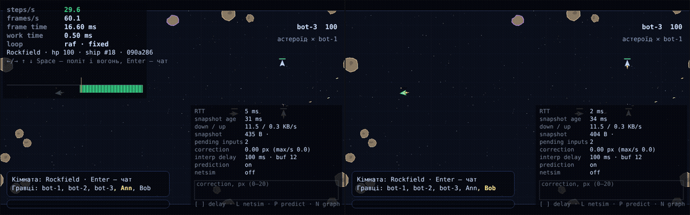

## Як грати

Відкрийте посилання, введіть ім'я, оберіть кімнату (або створіть свою) — друг відкриває те саме посилання і обирає ту саму кімнату.

| Клавіша      | Дія     | Клавіша    | Дія                                |
| ------------ | ------- | ---------- | ---------------------------------- |
| **←/→**, A/D | поворот | Enter      | чат                                |
| **↑**, W     | газ     | H          | показати/сховати HUD               |
| **↓**, S     | гальмо  | N, `[` `]` | netgraph, затримка інтерполяції    |
| **Space**    | вогонь  | L          | симуляція поганої мережі (пресети) |
|              |         | P          | вимкнути/увімкнути передбачення    |

На телефоні: «Додати на головний екран» — гра встановлюється як PWA і відкривається на весь екран (керування — з клавіатури, тач-керування не реалізоване).

## Запуск локально — три команди

Потрібен Node.js **22.18+** (`.nvmrc`; сервер виконує `.ts` напряму завдяки вбудованому зрізанню типів).

```bash
npm install
npm run dev          # сервер :8080 + Vite :5173 → http://localhost:5173
npm test             # 144 тести (Vitest) у shared/server/client
```

Ще: `npm run e2e` (Playwright: два браузери в одній кімнаті + хаос-тест «сервер упав»), `npm run check` (Biome), `npm run typecheck`, `npm run build && npm start` (production: сервер сам віддає `client/dist` на :8080), `docker compose up --build` (як у продакшні).

Корисні посилання в dev: `/?room=alpha&name=Ann` — одразу в кімнату; `/?offline` — без сервера; `/?fail=404|timeout|json|abort` — галерея відмов завантаження; `/?perf` — `performance.measure` для кадру; `/determinism.html` — хеш симуляції в браузері.

## Архітектура

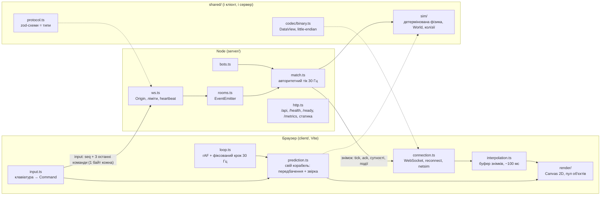

- **Цикл:** клієнт — `requestAnimationFrame` + акумулятор фіксованого кроку (симуляція 30 Гц, рендер з частотою дисплея, інтерполяція `alpha`); сервер — `setTimeout` з абсолютними цілями (без дрейфу).
- **Протокол** ([`docs/protocol.md`](docs/protocol.md)): JSON для рідкісних повідомлень (join, chat, roster), бінарні кадри для знімків і input. Кожне вхідне повідомлення проходить zod-схему; невалідне → закриття 4001.
- **Один інстанс.** Кімната живе в пам'яті одного процесу, тому сервер не масштабується горизонтально «просто так» — див. «Обмеження».

## Виміри — зведення

| Що                              | Результат                                                      | Де детальніше |
| ------------------------------- | -------------------------------------------------------------- | ------------- |
| Кодек: JSON → `DataView`        | 3267 → **469** байт/знімок (×7), вгору ×20                     | Лаба 5        |
| Затримка «клавіша → рух»        | 150 мс → **34 мс** (передбачення, RTT 100)                     | Лаба 5        |
| Алокації клієнта, 30 с бою      | 94.5 → **47.4** МБ; CPU 1560 → **807** мс                      | Лаба 7        |
| Довгі кадри (нативна швидкість) | 1 → **0** за 30 с, найдовший 16.8 мс                           | Лаба 7        |
| Колізії O(n²) → spatial hash    | tick p99 при 128 гравцях 10.2 → **5.7** мс                     | Лаба 7        |
| Ємність одного процесу          | 256 гравців: tick p99 17.9 мс із 33 мс; **межа — трафік** (N²) | Лаба 7        |
| Флуд сміттям з одного IP        | tick p99 сусідньої кімнати 1.4 → 3.4 мс, 0 пропущених тіків    | Лаба 8        |

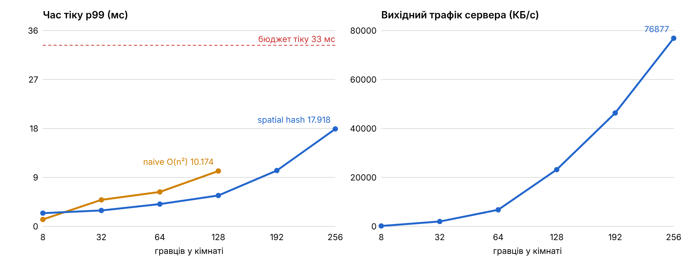

**Ємність і вузьке місце.** CPU витримує 256 гравців в одній кімнаті (бюджет тіку — 33 мс). Трафік росте як N²: 128 гравців у кімнаті = 22.6 МБ/с ≈ 180 Мбіт/с. На VPS зі 100 Мбіт/с одна кімната вміщує ≈ 90 гравців. Для реального сценарію — багато кімнат по 8 — межа інша: тік кімнати з 8 гравцями коштує ≈ 0.5 мс (p50), тож один процес (одне ядро) тягне ≈ 60 кімнат ≈ **500 гравців** (екстраполяція, не вимір), а трафік при цьому лише ≈ 7 МБ/с (≈ 14 КБ/с на гравця). Тобто для малих кімнат межа — CPU одного ядра, для великих — мережа.

**Реальна мережа (два гравці не в моїй мережі).** _Заповнити після плейтесту: місто → сервер (регіон waw), RTT з netgraph p50/p95, snapshot age, корекції._

| Гравець | Звідки  | RTT p50 / p95, мс | Корекцій за матч | Враження |
| ------- | ------- | ----------------- | ---------------- | -------- |
| A       | _місто_ | _—_               | _—_              | _—_      |
| B       | _місто_ | _—_               | _—_              | _—_      |

## Обмеження — і чому так

- **Один інстанс сервера.** Стан кімнати — у пам'яті одного процесу; два інстанси за round-robin балансувальником розділили б кімнату. Для курсу правильно: ємності одного процесу вистачає з запасом (вище). Деплой — `strategy = "immediate"`: під час деплою матчі обриваються, клієнти перепідключаються за кілька секунд.
- **Інтерполяція у минулому на 100 мс.** Чужі кораблі показані такими, якими були 100 мс тому, — плата за плавність при джитері.
- **Немає компенсації лагу** (rewind на сервері). Влучання рахується в «теперішньому» сервера, тож при RTT 150+ треба цілитись з упередженням.
- **Немає акаунтів і матчмейкінгу** — кімнати за назвою, ім'я довільне.
- **Немає тач-керування** — на телефоні PWA встановлюється, але грати треба з клавіатурою.
- **Free tier може «заснути»** — `auto_stop_machines = "off"` у `fly.toml` це вимикає, але на безкоштовних тарифах інших платформ перший гравець чекатиме ~30 с.

## Що я зробив би далі

1. **Area of interest** — слати кожному лише сутності поблизу: трафік з N² стане ≈ N, ємність кімнати виросте в рази.
2. **Дельта-знімки** — лише змінені поля відносно останнього підтвердженого (`ack`).
3. **Кілька інстансів:** спершу **sticky routing** за id кімнати (`hash $room` у nginx або Fly-Replay), далі **Redis pub/sub** між інстансами, щоб кімната могла жити на кількох процесах.
4. **Компенсація лагу** — сервер «відмотує» світ на RTT стрілка під час перевірки влучання.
5. Матчмейкінг, акаунти, таблиця рекордів; тач-керування для телефонів.

## Деплой

`git tag v1.0.0 && git push --tags` → `.github/workflows/deploy.yml`: CI (typecheck, Biome, тести, e2e) → образ у **GHCR** (build-arg `APP_VERSION=<тег>-<sha>`) → `flyctl deploy` → smoke-тест: `/health` має повернути саме цю версію.

Підготовка (один раз): `fly launch --no-deploy` (назва app, регіон `waw`) → змінити `app` і `ALLOWED_ORIGINS` у `fly.toml` → `fly tokens create deploy` → секрет репозиторію `FLY_API_TOKEN`. TLS завершує край Fly (сертифікат автоматичний), браузер ходить на `wss://`, до процесу доходить звичайний `ws` на :8080.

## Історія тегів

| Тег                | Що з'явилось                                                                                              |
| ------------------ | --------------------------------------------------------------------------------------------------------- |
| `lab-01`           | rAF-цикл з фіксованим кроком, Canvas, корабель, експерименти з event loop                                 |
| `lab-02`           | сутності на класах, `World` з `Map`, генератори, композиція (самонавідність, ефекти)                      |
| `lab-03`           | асинхронне завантаження: `Promise.all`, таймаути, повтори з backoff, лобі, Web Audio                      |
| `lab-04`           | Node-сервер: http, кімнати на `EventEmitter`, WebSocket, NDJSON-журнали, ліміти                           |
| `lab-05`           | спільна детермінована симуляція, авторитетний сервер 30 Гц, передбачення, інтерполяція, бінарний протокол |
| `lab-06`           | TypeScript strict, zod-протокол як джерело типів, типізовані події, Vitest, CI                            |
| `lab-07`           | тести властивостей, e2e, профілювання, рендер без алокацій, spatial hash, боти, навантажувальний тест     |
| `lab-08`, `v1.0.0` | продакшн: pino, `/metrics`, `/ready`, Origin, ліміти на IP, хаос-тести, Docker, CD, PWA, дашборд          |

Кожна лаба — окремий тег: `git checkout lab-03` показує проєкт рівно на момент здачі третьої лаби. Нижче — журнал лаб (шляхи в розділах 1–3 вказані до переїзду в `client/` у Лабі 4).

---

## Лаба 1 — Event loop — це і є ігровий цикл

### Структура (на момент Лаби 1)

```
index.html               <canvas> + <script type="module" src="/src/main.js">
src/
  main.js                склеює модулі, запускає цикл
  loop.js                createLoop({ step, simulate, render }) — rAF + акумулятор
  input.js               createInput(target) — замикання над станом клавіш; readCommand()
  experiments.js         перемикачі експериментів через URL + рекордер метрик
  sim/ship.js            стан корабля, integrate(ship, input, dt), lerpShip, lerpAngle
  sim/arena.js           розмір арени, wrap()
  render/canvas.js       canvas з урахуванням devicePixelRatio, resize, letterbox
  render/draw.js         drawBackground, drawShip, drawHud (+ гістограма кадрів)
scripts/determinism.js   прогін фізики в Node з різною «частотою кадрів»
```

### Ключові рішення

- **Фіксований крок 1/60 с + акумулятор** (`loop.js`). Delta кадру обрізається до 0.25 с, щоб після зависання чи повернення у вкладку не було «спіралі смерті» — тисяч кроків наздоганяння.
- **Інтерполяція.** Тримаю `previous` і `current`; `render(alpha)` малює `lerpShip(previous, current, alpha)`. Кут інтерполюється найкоротшим шляхом (`lerpAngle` через `wrapAngle`) — інакше перехід 179° → −179° на мить крутить корабель на 358°. Позиція теж враховує загортання: якщо корабель перелетів через край, `previous` зсувається на ширину арени, щоб не було «стрибка через увесь екран».
- **Симуляція не знає про DOM.** `integrate()` отримує не клавіатуру, а команду `{ turn, thrust, brake }` (її будує `readCommand(input)`). Повертає новий об'єкт, вхідний не мутує. Цей самий модуль запускається в Node (`npm run determinism`) — а в Лабі 5 запуститься на сервері.
- **`justPressed`.** Фронт натискання записується в окремий `Set` і очищається викликом `input.endStep()` _після кроку симуляції_, а не після кадру. Так натискання не губиться, якщо в кадрі не було жодного кроку (144 Гц), і не спрацьовує двічі, якщо кроків було кілька. Автоповтор ОС (`e.repeat`) ігнорується; на `blur` стан очищається, щоб корабель не «залипав» з газом.
- **Арена фіксованого розміру** 1600×900 світових px; вікно лише масштабує картинку з полями. Інакше гравець з ширшим монітором бачив би більше світу.
- **DPR.** Буфер canvas = CSS-розмір × `devicePixelRatio`, трансформація `setTransform(dpr·scale, …)`. Зміна DPR (перетягування на інший монітор, zoom) відстежується через `matchMedia('(resolution: …dppx)')`, розмір — через `ResizeObserver`.

### Тюнінг польоту

| Параметр      | Значення                 | Чому                                                                                               |
| ------------- | ------------------------ | -------------------------------------------------------------------------------------------------- |
| `turnRate`    | 3.6 рад/с                | 2.5 — розворот здавався «важким»; 5 — неможливо точно прицілитись                                  |
| `thrustAccel` | 520 px/с²                | до максимуму ≈ 1.3 с — відчувається інерція, але не нудно                                          |
| `drag`        | 0.55 /с (експоненційний) | корабель «пливе» після відпускання газу ~3 с; лінійне `v*(1-k·dt)` змінює поведінку при великих dt |
| `maxSpeed`    | 560 px/с                 | арену 1600 px перетинаєш за ~3 с                                                                   |
| `brakeDrag`   | +3.0 /с                  | гальмо зупиняє за ~1 с                                                                             |

---

## Експерименти «зламай навмисно і поміряй»

Кожен експеримент вмикається параметром URL, код гри при цьому не змінюється. Рекордер (`experiments.js`) після 1 с прогріву записує 10 с інтервалів між кадрами, виводить результат у HUD і в консоль (`console.table`).

> **Звідки числа.** Колонка «еталон» — прогін у headless Chromium 1194 (1280×720, DPR 2, віртуальний 60 Гц vsync). Колонки «мій ноутбук» — мій ноутбук з Windows 11, дисплей 60 Гц: експерименти 1 і 3 (з CPU 6×) і «фонова вкладка» — у Microsoft Edge; решта експерименту 2 і експеримент 3 без throttling — у вбудованому Chromium 156 (DPR 1.25). Виміри — з версії гри після Лаби 8 (`/?offline&exp=…`).

### Експеримент 1 — синхронний блок у кадрі (`/?exp=block`)

У `render` кожен 60-й кадр виконується `while (performance.now() < t + 100) {}`.

| Метрика        | Норма (еталон) | Блок (еталон) | Блок (мій ноутбук) |
| -------------- | -------------- | ------------- | ------------------ |
| frames/s       | 59.6           | **55.3**      | **55.55** (норма 60.05)  |
| steps/s        | 60.0           | **60.06**     | **59.95**          |
| frame time p50 | 16.7 мс        | 16.7 мс       | 16.6 мс            |
| frame time p99 | 21.0 мс        | **111.1 мс**  | **101.8 мс** (норма 17.7) |
| max frame time | 97.7 мс*       | **116.7 мс**  | **102.2 мс** (норма 19.5) |
| джитер (σ)     | 3.47 мс        | **12.3 мс**   | **10.77 мс** (норма 0.36) |

\* поодинокий спалах на старті headless-браузера.

**Що бачить гравець:** раз на секунду корабель «замерзає» на ~0.1 с, а потім ривком перестрибує вперед. На гістограмі HUD — червоний стовпчик раз на 60 кадрів.

**Що роблять числа:** frames/s падає (за секунду 100 мс просто втрачено — це ~6 кадрів), а **steps/s лишається 60**: після блоку акумулятор містить ~0.1 с, і цикл виконує ~6 кроків поспіль, наздоганяючи реальний час. Тобто симуляція коректна, страждає лише картинка — саме тому й «ривок».

**Чому це не обійти з JavaScript на тому ж потоці.** Event loop бере наступну задачу лише коли стек викликів порожній. Поки `while` крутиться, стек не порожній: не виконуються ні rAF-колбеки, ні обробники клавіш, ні таймери, ні мікрозадачі, браузер не може відмалювати кадр. JavaScript run-to-completion — функцію неможливо перервати зсередини того ж потоку, а будь-який «рятівний» код (setTimeout, promise, обробник подій) сам стоїть у черзі _за_ цим блоком. Варіанти — лише прибрати блок: розбити роботу на шматки між кадрами або винести її у Web Worker (інший потік).

### Експеримент 2 — `setInterval(frame, 16)` замість rAF (`/?exp=interval`)

| Метрика                    | rAF (еталон) | setInterval (еталон)            | rAF (мій) | setInterval (мій) |
| -------------------------- | ------------ | ------------------------------- | --------- | ----------------- |
| frames/s                   | 59.6         | **62.0**                        | 60.03     | **62.50**         |
| mean frame time            | 16.78 мс     | **16.13 мс**                    | 16.66 мс  | **16.00 мс**      |
| джитер (σ)                 | 3.47 мс      | 2.79 мс                         | 0.62 мс   | 0.68 мс           |
| p99                        | 21.0 мс      | 18.7 мс                         | 17.3 мс   | 17.9 мс           |
| фонова вкладка: кадрів     | 0 (пауза)    | ~1/с (браузер тротлить таймери) | **30** за 6 с; один «кадр» 5.5 с | **584** за 10 с |

**Що відрізнялось:**

1. **62 «кадри» на секунду на 60 Гц дисплеї.** 16 мс ≠ 16.667 мс, тож таймер спрацьовує частіше за vsync: ~2 рази на секунду два виклики потрапляють в один інтервал оновлення екрана — один кадр малюється даремно, а фаза таймера відносно vsync повільно «пливе» → періодичне посмикування (judder). На 120/144 Гц моніторі setInterval так і лишиться ~62 fps, а rAF дасть 120/144.
2. **Таймер — це macrotask, а не крок рендерингу.** Колбек setInterval стає в чергу задач і виконується «коли дійде черга», не обов'язково безпосередньо перед paint. rAF браузер викликає саме в фазі рендерингу, синхронізовано з дисплеєм.
3. **Фон.** rAF у прихованій вкладці не викликається взагалі (нуль роботи, батарея ціла); після повернення перший кадр має delta ≈ 5 с, яку обрізає clamp 0.25 с. setInterval у фоні продовжує тікати (Chrome тротлить до ~1 разу на секунду), і кожен тік виконує симуляцію й даремний рендер.

Числовий джитер в headless тут не показовий (віртуальний vsync), тому на реальному моніторі обов'язково заміряй сам — зазвичай setInterval дає помітно більший розкид.

> В headless-режимі не вдалося емулювати `visibilityState = "hidden"`, тому в колонках «еталон» рядок про фонову вкладку — очікувана поведінка за специфікацією.

**Фонова вкладка на моєму ноутбуці (Edge).** rAF зупинився: за 6 с у фоні — 30 кадрів (момент перемикання, поки `document.hidden` ще не змінився), а найдовший «кадр» тривав 5469 мс — це і є пауза. steps/s за запис упали до 28.7, бо після паузи clamp 0.25 с «викинув» майже 5 с симуляції — замість тисяч кроків наздоганяння. **setInterval у фоні тікав майже на повній швидкості** — 584 виклики за 10 с, без тротлінгу до 1/с. Пояснення: у грі грає фоновий звук, а браузери не гальмують таймери у вкладці, що відтворює аудіо. Висновок той самий, тільки гостріший: rAF у фоні завжди стоїть, а таймер залежить від політики браузера — і може даремно рахувати й малювати.

### Експеримент 3 — змінний крок замість фіксованого (`/?exp=variable&autopilot=1`)

`autopilot` тримає «газ» без людини, щоб вхід був ідентичним. Позиція логується, коли симульований час досягає 5 с. Throttling — DevTools → Performance → CPU: 6× slowdown (в еталоні — CDP `Emulation.setCPUThrottlingRate`).

**У браузері** (y — «розгорнута» координата без загортання, корабель стартує носом вгору):

| Режим    | CPU           | кроків | simTime | y через 5 с   |
| -------- | ------------- | ------ | ------- | ------------- |
| fixed    | 1×            | 300    | 5.0000  | **−1962.868** |
| fixed    | 6×            | 300    | 5.0000  | **−1962.868** |
| variable | 1×            | 301    | 5.0091  | −1968.043     |
| variable | 6× (прогін 1) | 89     | 5.0196  | −1983.176     |
| variable | 6× (прогін 2) | 59     | 5.0458  | −2000.021     |

**На моєму ноутбуці** (версія після Лаби 8: фізика вже з астероїдами й відскоками, тому числа інші, ніж у таблиці вище, — порівнювати лише між собою; консоль друкує зміщення `dx`, `dy` за 5 с):

| Режим    | Браузер, CPU            | кроків | simTime | dx, px       | dy, px        |
| -------- | ----------------------- | ------ | ------- | ------------ | ------------- |
| fixed    | Chromium 156, 1×, прогін 1 | 300 | 5.0000  | **−60.033**  | **−2204.672** |
| fixed    | Chromium 156, 1×, прогін 2 | 300 | 5.0000  | **−60.033**  | **−2204.672** |
| fixed    | Edge, 6×                | 300    | 5.0000  | **−60.033**  | —             |
| variable | Chromium 156, 1×, прогін 1 | 301 | 5.0055  | −442.845     | −2237.999     |
| variable | Chromium 156, 1×, прогін 2 | 301 | 5.0054  | −442.845     | −2237.940     |
| variable | Edge, 1×                | —      | —       | −450.892     | —             |
| variable | Edge, 6×, прогін 1      | —      | —       | −446.734     | —             |
| variable | Edge, 6×, прогін 2      | —      | —       | −435.257     | —             |
| variable | Edge, 6×, прогін 3      | —      | —       | −250.075     | —             |

Фіксований крок дав **той самий dx до тисячних** у двох браузерах, з throttling і без. Змінний «пливе» навіть між двома прогонами без навантаження, а під CPU 6× розкид — до 200 px: один прогін траєкторія по-іншому зачепила астероїд, і далі все пішло інакше. Цікаво, що навіть під 6× гра тримала ~56–60 fps (робота кадру 5.4 мс із 16.7) — тобто для розбіжності не потрібні «повільні кадри», досить того, що кожен кадр має трохи інший dt.

**В Node** (`npm run determinism`, тривалість останнього кроку обрізана рівно до 5 с — видно чисту похибку інтегрування):

| «Частота кадрів»            | fixed x, px | variable x, px | variable кроків |
| --------------------------- | ----------- | -------------- | --------------- |
| 60 Гц                       | 2412.867660 | 2412.867660    | 300             |
| 144 Гц                      | 2412.867660 | 2411.568405    | 720             |
| 30 Гц                       | 2412.867660 | 2415.056092    | 150             |
| ~10 fps з джитером (CPU 6×) | 2412.867660 | 2423.578414    | 51              |

**Висновок.** Зі змінним кроком траєкторія залежить від того, як «нарізано» час: напівнеявний Ейлер з dt = 1/10 с і з dt = 1/144 с дає різні числа (до 12 px розбіжності за 5 с), а в браузері до цього додається ще й «переліт» за межу 5 с, бо останній кадр не підлаштовується під неї. Навіть два прогони з одним і тим самим throttling дали різні результати (−1983 vs −2000), бо тривалості кадрів недетерміновані. З фіксованим кроком симуляція отримує **однакову послідовність dt = 1/60** незалежно від монітора й навантаження — і позиція збігається **біт-у-біт**. Повільна машина просто робить кілька кроків за кадр.

Саме це потрібно для мультиплеєра (Лаба 5): сервер і клієнт мають отримати однаковий результат з однакових входів, інакше клієнтське передбачення постійно розходитиметься з сервером.

---

## Reflection — тези до захисту

1. **Runtime:** стек викликів + heap (рушій V8) · Web APIs (таймери, DOM-події, fetch — у браузері) · черга задач · черга мікрозадач · кроки рендерингу (rAF → style → layout → paint). `setTimeout(f, 0); Promise.resolve().then(g)`: обидва колбеки йдуть у черги; стек звільнився → спершу повністю вичищаються мікрозадачі (`g`), потім береться одна задача (`f`).
2. **100 мс синхронного циклу** тримають стек зайнятим: event loop не може взяти нічого — ні події, ні rAF, ні paint. З того самого потоку зробити нічого не можна — лише не блокувати (розбити роботу / Worker). CSS-анімації на compositor-потоці (transform, opacity) іноді продовжують рухатись, решта стоїть.
3. **Правило:** одна задача за ітерацію; після кожної задачі (і кожного колбека) черга мікрозадач вичищається _повністю_, включно з новими. Тому ланцюжок мікрозадач ніколи не відпускає потік до рендерингу, а ланцюжок `setTimeout` — відпускає між задачами.
4. **rAF** — після задачі й мікрозадач, у фазі рендерингу, безпосередньо перед style/layout/paint. Краще за `setInterval(fn, 16)`: (а) синхронізований з частотою дисплея (60/120/144), (б) немає дрейфу 16 ≠ 16.667 і подвійних/пропущених кадрів, (в) пауза у фоновій вкладці, (г) один timestamp на всі колбеки кадру.
5. **Акумулятор:** накопичуємо реальний час, віднімаємо фіксовані кроки, поки вистачає; залишок `/ step = alpha` — частка шляху до наступного кроку, на яку рендер інтерполює між `previous` і `current`. Clamp 0.25 с — щоб після довгої паузи не виконати тисячі кроків поспіль (спіраль смерті).
6. **Детермінізм:** однакові входи → однаковий стан на будь-якій машині. У Лабі 5 клієнт передбачає рух і звіряє з сервером; недетермінована фізика дасть постійні розбіжності й «гумові» стрибки.
7. **Замикання захоплює змінні, а не значення.** `for (var i…)` — одна змінна `i` на всю функцію, всі колбеки бачать 3. `for (let i…)` — нова прив'язка `i` на кожну ітерацію → 0, 1, 2. У `createInput` колбеки та повернені функції ділять одні й ті самі `down`/`pressed`.
8. **`type="module"`:** власна область видимості файлу (немає глобальних змінних), strict mode, `import`/`export` (статичний граф, live bindings), відкладене виконання як `defer`, top-level `await`, `this === undefined` на верхньому рівні, модуль виконується один раз, CORS для завантаження.

## Що далі (stretch)

Гістограма часу кадру вже є в HUD (240 кадрів, червоне — понад 16.7 мс). Не зроблено: Gamepad API, touch-керування, симуляція у Web Worker.

---

## Лаба 2 — Об'єкти, прототипи та `this`: модель сутностей

### Структура

```
src/sim/
  vector.js              Vector2 — незмінний вектор, усі методи чисті
  entity.js              Entity — база: static #nextId, #id, pos/vel/angle/radius/alive/kind, update(dt)
  entities/ship.js       Ship extends Entity — #hp + get hp(), damage(), fire(world), effects
  entities/bullet.js     Bullet extends Entity — ttl, damage, ownerId
  entities/asteroid.js   Asteroid extends Entity — дрейф, обертання, відскок, розкол
  entities/pickup.js     Pickup extends Entity — нерухомий підсилювач (shield / rapid / homing)
  entities/explosion.js  Explosion extends Entity — короткоживучі частинки
  world.js               World — Map сутностей, spawn/despawn/get, [Symbol.iterator], *ofKind, step()
  collision.js           система колізій: генератор пар (a, b), O(n²)
  rules.js               таблиця «пара типів → обробник»: шкода, рахунок, відскок, підбір
  behaviors.js           композиція: withHoming() + homingSystem()
  physics.js             integrate() з Лаби 1 (тепер на Vector2), wrapAngle, lerpAngle
  arena.js               розмір, wrapPos, torusDelta (найкоротший вектор через край)
  rng.js                 mulberry32 — детермінований ГПВЧ замість Math.random()
  ai.js                  dummyPilot — «пілот» тренувального манекена (чиста функція)
scripts/this-bug.js      відтворення бага з this і три виправлення
```

**Ієрархія — рівно один рівень:** `Ship`, `Bullet`, `Asteroid`, `Pickup`, `Explosion` → `Entity`. Усе, що мало б стати другим рівнем (`HomingBullet`, `HunterAsteroid`, `ShieldedShip`), зроблено композицією.

### Як влаштований крок світу

`World.step(dt, inputs)`:

1. `savePrev()` усім (для інтерполяції в рендері).
2. Команди з `inputs: Map<shipId, command>` кладуться в кораблі.
3. `update(dt, world)` кожної сутності, потім `wrapPos` (тор).
4. `homingSystem` — повертає швидкість усіх сутностей із компонентом `homing`.
5. `collide(world)` — генератор пар; кожна пара → `resolveCollision` за таблицею правил.
6. «Режисер» підтримує 5 астероїдів і раз на 6 с підкидає підсилювач.
7. **Відкладене прибирання:** `despawn(id)` лише ставить `alive = false` і кладе id у чергу; з `Map` сутність видаляється в кінці кроку. Тому куля, що влучила в два об'єкти одночасно, не «зникає посеред обходу», а другий обробник просто бачить `alive === false` і нічого не робить.

**Чому `Map`, а не `{}`:** (1) ключі-числа лишаються числами, (2) гарантований порядок обходу — порядок вставки, а це детермінізм симуляції (Лаба 5), (3) `delete` швидкий і не ламає форму об'єкта (V8 не переводить його в «словниковий режим»), (4) `.size` і власний ітератор, (5) жодних конфліктів з `Object.prototype` (`"constructor"`, `"__proto__"`).

**Детермінізм:** уся випадковість — з `world.rng` (mulberry32). Перевірено: два прогони по 2 хвилини гри двох ботів з тим самим зерном дають ідентичні позиції, здоров'я й рахунок.

### Баг з `this`

**Як виник.** Хотілося повісити окремий постріл на клавішу F через новий `input.onPress(code, fn)`:

```js
input.onPress("KeyF", player.fire); // ✘
```

Натискання → `TypeError: Cannot read properties of undefined (reading 'destroyed')`. Обробник клавіатури викликає колбек як `fn(e)` — без об'єкта перед крапкою. Метод `fire` — звичайна функція на `Ship.prototype`, і `this` для неї визначає **спосіб виклику**, а не місце оголошення. Виклик «без отримувача» в strict mode (а модулі завжди strict) дає `this === undefined`. Друга, тихіша проблема: першим аргументом прийшов би `KeyboardEvent`, а не `world`.

Відтворення: `npm run this-bug` — той самий метод, викликаний як `ship.fire(world)`, як відірвана функція і через `setTimeout`:

```
✔ ship.fire(world): куля #2
✘ const f = ship.fire; f(world): TypeError: Cannot read properties of undefined (reading 'destroyed')
✘ setTimeout(ship.fire) — колбек без отримувача: TypeError: ...
✔ () => ship.fire(world): куля #3
✔ ship.fire.bind(ship, world): куля #4
✔ поле-стрілка (без отримувача): куля #6
ship.fire === ship2.fire (метод прототипу, спільний): true
ship2.fireArrow === іншого екземпляра (поле, своє в кожного): false
ланцюжок прототипів ship: ship → Ship → Entity → Object → null
```

| Виправлення                     | Як                                                | Мінус                                                                                                            |
| ------------------------------- | ------------------------------------------------- | ---------------------------------------------------------------------------------------------------------------- |
| **Стрілкова обгортка (обрано)** | `input.onPress("KeyF", () => player.fire(world))` | нова функція на кожну реєстрацію; щоб відписатись, треба зберегти посилання                                      |
| `bind`                          | `player.fire.bind(player, world)`                 | `this` прибито назавжди (повторний `bind`/`call` не змінить); та сама проблема з відпискою                       |
| Поле класу-стрілка              | `fire = (w) => { … }` у класі                     | окрема копія функції в **кожному** екземплярі замість одного методу на прототипі; не перевизначити через `super` |

Обрано стрілкову обгортку: вона явно показує в місці виклику, на кому і з якими аргументами викликається метод, і не змінює клас. У `main.js` поруч залишено закоментований «баговий» рядок з поясненням.

### Композиція замість успадкування

**Задача.** Дві поведінки, які «перетинають» ієрархію:

- **наведення (homing)** має працювати і для кулі, і для астероїда-«мисливця»;
- **підсилювач (pickup)** — нерухомий, має колізію, але це не корабель; його ефект (щит, швидкострільність, самонавідні кулі) має отримувати корабель.

**Як виглядала б ієрархія.** `Entity → MovingEntity → Projectile → Bullet → HomingBullet` і окремо `Entity → MovingEntity → Asteroid → HomingAsteroid`. Логіка наведення дублюється у двох гілках або виноситься в спільного предка `HomingEntity`, і тоді **всі** кулі й астероїди тягнуть її з собою. Щит і швидкострільність — ще `ShieldedShip`, `RapidFireShip`, `ShieldedRapidFireShip`… комбінаторний вибух класів. А якщо ефект має **з'являтися й зникати під час гри** (підібрав → 8 с → минуло) — клас об'єкта змінити неможливо, тож довелося б перестворювати сутність.

**Що зроблено — явні поля-компоненти + системи (behavior-as-data):**

- `entity.homing = { targetKind, turnRate, range, ignoreId }` — **дані**. `withHoming(entity, opts)` їх додає (`behaviors.js`), а `homingSystem(world, dt)` раз на крок обходить світ і повертає швидкість **будь-якої** сутності, у якої компонент не `null`. Кулі отримують його в `Ship.fire()`, коли в корабля активний ефект `homing`; кожен п'ятий астероїд — у `spawnAsteroid()`. Код наведення один, класів-нащадків нуль.
- `ship.effects = { shield, rapid, homing }` — секунди, що лишились. `Pickup.applyTo(target)` нічого не знає про кораблі: він кладе тривалість у `effects` будь-кого, хто цей компонент має. `Ship.damage()` читає `effects.shield`, `Ship.fire()` — `effects.rapid` і `effects.homing`. Ефекти з'являються, спадають і зникають без зміни класу.
- **Правила колізій — теж дані:** таблиця `"bullet:ship" → handler` у `rules.js`. Новий тип сутності = нові рядки, а не `instanceof`-ланцюжки по всьому коду.

**Чому не міксини (`Object.assign(Bullet.prototype, Homing)`):** міксин змінює **всі** кулі назавжди і на рівні прототипу; нам потрібно ввімкнути поведінку для **конкретної** кулі на час дії ефекту. Компонент-поле — це стан екземпляра, його можна додати, змінити й прибрати в будь-який момент, і він серіалізується в знімок для мережі (Лаба 5) як звичайні дані.

**Ціна:** перевірка `if (!e.homing) continue` для кожної сутності на кожному кроці й «невидимий» зв'язок між полем і системою (треба знати, що десь існує `homingSystem`). Для кількох сотень сутностей це непомітно; у Лабі 7 можна зберігати компоненти в окремих масивах (ECS), щоб система обходила лише тих, у кого компонент є.

### Колізії, шкода, респавн

- `collision.js` — наївний O(n²) генератор пар із урахуванням тора; підставляється в `World` параметром `collide`, тож просторовий хеш у Лабі 7 замінить лише цей модуль.
- Кулі шкодять кораблям (20) і астероїдам; великі астероїди розколюються на два; удар об астероїд — шкода пропорційна відносній швидкості.
- Здоров'я — приватне `#hp`, назовні лише `get hp()`; змінити можна тільки через `damage()` / `respawn()`.
- Знищення → `Explosion` (28 частинок, 0.9 с) → через 2 с респавн у найбезпечнішій із 30 випадкових точок + 1.5 с щита.
- Рахунок: 100 за корабель, 25 за астероїд; показаний зверху екрана.

---

## Лаба 3 — Асинхронний JavaScript: Promises, async/await і екран завантаження

### Що з'явилось

```
public/assets/manifest.json     список ресурсів: id, type (image | json | audio), url, optional
public/assets/sprites/          sheet.png + atlas.json — спрайт-аркуш (згенерований scripts/make-assets.mjs)
public/assets/sounds/           shoot / hit / explosion / pickup / ambient (.wav, синтезовані кодом)
public/assets/arenas/*.json     конфіги арен для кімнат
public/api/rooms.json           статичний список кімнат (у Лабі 4 його замінить справжній сервер)
src/assets/loader.js            fetchChecked, fetchJson, loadImage, loadAudio, loadJson, withRetry, loadAll
src/audio.js                    єдиний AudioContext, розблокування на жесті, attachAudio(bus)
src/hud.js                      рахунок, «+100», стрічка подій — лише слухає події
src/lobby/lobby.js              class Lobby extends EventTarget — модель без DOM
src/lobby/view.js               DOM-рендер лобі, слухає події моделі
src/render/loading.js           екран завантаження: смуга прогресу на canvas + кнопки відновлення
src/render/sprites.js           малювання кадрів аркуша через drawImage(sheet, sx, sy, sw, sh, …)
src/game.js                     локальна гра (колишній main.js)
src/main.js                     сценарій: завантаження → лобі → гра (один async-ланцюжок)
vite.config.js                  middleware для навмисних збоїв і штучної затримки
docs/lab-03/                    задачі на порядок виконання + скриншоти галереї відмов
```

### Конвеєр завантаження

- **Кожен завантажувач приймає `AbortSignal`**, а таймаут — це теж сигнал: `AbortSignal.any([signal, AbortSignal.timeout(ms)])`. Зображення вантажаться через `fetch → blob → createImageBitmap`, а не `new Image()`, бо так працюють і скасування, і перевірка статусу.
- **`fetchChecked` перевіряє `response.ok`.** `fetch` відхиляє проміс лише на мережеву помилку чи abort; 404 і 500 для нього — успішні HTTP-відповіді. Без перевірки 404 «завантажився б», а впав би вже на декодуванні.
- **`withRetry(fn, { attempts, baseMs, signal })`** — затримка `baseMs · 2^(n−1) · [0.5, 1.5)`. Джитер розносить повтори тисяч клієнтів у часі. **Не повторюємо:** 4xx (запит неправильний — повтор дасть те саме), `SyntaxError` (зіпсований JSON не виправиться), abort. **Повторюємо:** мережеву помилку, `TimeoutError`, 5xx, 408, 429.
- **`loadAll(manifest, { onProgress, signal })`** запускає все одночасно через `Promise.all`. Обов'язковий ресурс, що впав, відхиляє весь `loadAll` — «все або нічого». Необов'язковий ловиться всередині й повертає `null`, а гра працює без нього: без `ambient` — без фонового звуку, без аркуша — векторні фігури з Лаби 2.
- Гра стартує лише після `await loadAll(...)`. Esc під час завантаження скасовує все одним `controller.abort()`.

**Навмисні збої в маніфесті:** `decor.nebula` посилається на файл, якого немає (404, необов'язковий), а `ambient.wav` dev-сервер завжди віддає із затримкою 1.5 с («повільний ресурс»).

### Заміри: послідовно проти `Promise.all`

8 ресурсів, штучна затримка 150 мс на кожен (`LATENCY_MS=150`), headless Chromium, по 3 прогони:

| Режим                            | Без повільного ресурсу (`SLOW_MS=0`) | З повільним `ambient.wav` (+1.5 с) |
| -------------------------------- | ------------------------------------ | ---------------------------------- |
| послідовні `await` (`?seq`)      | 1116 / 1120 / 1124 мс                | 2624 / 2627 / 2621 мс              |
| `Promise.all` (за замовчуванням) | **328 / 340 / 336 мс**               | **1844 / 1834 / 1834 мс**          |
| виграш                           | ×3.3                                 | ×1.4                               |

Послідовно час = **сума** затримок (7 × 150 мс + декодування; 404 приходить миттєво). Паралельно — **максимум** (≈150 мс + декодування). З повільним ресурсом паралельний час упирається в нього: `Promise.all` чекає найповільнішого. Саме тому фоновий звук необов'язковий — у Stretch його варто вантажити вже після старту гри.

Відтворити: `LATENCY_MS=150 SLOW_MS=0 npm run dev`, потім відкрити `/?fast` і `/?seq&fast` і прочитати `__lab.loadMs` у консолі.

### Звук і розв'язання через події

- `World extends EventTarget`: симуляція диспетчеризує `CustomEvent` `"fired"`, `"hit"`, `"exploded"`, `"picked"`, `"scored"`. `audio.js` і `hud.js` підписуються через `addEventListener`.
- **У `src/sim/` немає жодного імпорту `audio.js` чи `hud.js`** (`grep -rln "from.*\(audio\|hud\)" src/sim/` → 0 файлів). Тому той самий `World` у Лабі 5 запуститься на сервері, де немає ні звуку, ні екрана: `EventTarget` і `CustomEvent` вбудовані і в Node.
- `AudioContext` створюється одразу (стан `suspended`), буфери декодуються **під час завантаження**, а `resume()` викликається на першому `pointerdown` / `keydown` — політика автовідтворення браузерів.

### Лобі

- `class Lobby extends EventTarget` — без DOM. Події: `loading`, `rooms`, `error`, `join`, `left`. `view.js` лише слухає їх і викликає `refresh()` / `join()`; від усіх подій відписується одним `AbortController` (`addEventListener(..., { signal })`).
- **Періодичне оновлення** кожні 5 с, поки лобі на екрані. Новий `refresh()` скасовує попередній незавершений запит.
- **Кожен запит має `AbortSignal.timeout(3000)`.** Таймаут → у лобі «сервер не відповів за 3 с» і кнопка «Повторити».
- **`leave()`** зупиняє інтервал і робить `abort()` запиту в польоті — «осиротілих» запитів після входу в кімнату немає.
- `join(roomId)` вантажить конфіг арени кімнати (з повторами) → подія `join` → `startGame()` з розміром арени, кількістю астероїдів і зерном цієї кімнати.
- **Подія → проміс:** `lobby.waitForJoin()` = `new Promise(r => lobby.addEventListener("join", e => r(e.detail), { once: true }))`. Через це `main.js` читається як послідовний сценарій: `await loadAssets()` → `await lobby.waitForJoin()` → `startGame()`.

### П'ять задач на порядок виконання

Код — `docs/lab-03/puzzles.js`; перевірено в Chromium (`/docs/lab-03/puzzles.html` у dev-сервері), три прогони — однаковий результат.

**1. async-функція до і після `await`**

```js
log("A");
(async () => {
  log("B");
  await null;
  log("C");
})();
Promise.resolve().then(() => log("D"));
log("E");
```

**`A B E C D`** — тіло async-функції до першого `await` виконується синхронно (`B`); продовження після `await` стає мікрозадачею раніше, ніж `.then` з наступного рядка (`C` перед `D`).

**2. `setTimeout` всередині `.then`**

```js
setTimeout(() => log("T1"), 0);
Promise.resolve()
  .then(() => {
    log("P1");
    setTimeout(() => log("T2"), 0);
  })
  .then(() => log("P2"));
log("S");
```

**`S P1 P2 T1 T2`** — уся черга мікрозадач (і `P2`, доданий під час `P1`) вичищається до першої задачі-таймера; `T2` поставлено в чергу задач пізніше за `T1`.

**3. `requestAnimationFrame` проти таймера і мікрозадачі**

```js
requestAnimationFrame(() => {
  log("R");
  Promise.resolve().then(() => log("R-micro"));
});
setTimeout(() => log("T"), 0);
Promise.resolve().then(() => log("P"));
log("S");
```

**`S P T R R-micro`** — rAF виконується на кроці рендерингу, до якого зазвичай ще ~16 мс, а таймер — найближча задача. Мікрозадачі вичищаються і після кожного rAF-колбека, тому `R-micro` одразу за `R`. (Якщо кадр припаде рівно між задачами, `R` може обігнати `T` — порядок rAF і таймера не гарантований.)

**4. `queueMicrotask` і ланцюжок `.then`**

```js
Promise.resolve()
  .then(() => log(1))
  .then(() => log(2));
queueMicrotask(() => {
  log(3);
  queueMicrotask(() => log(4));
});
Promise.resolve().then(() => log(5));
```

**`1 3 5 2 4`** — у черзі спочатку `[1, 3, 5]`; `2` і `4` додаються лише тоді, коли виконаються `1` і `3`, тож стають у кінець.

**5. `await` результату async-функції проти `.then`**

```js
async function f() {
  log("f-start");
  return "v";
}
f().then((v) => log(`then:${v}`));
(async () => {
  const v = await f();
  log(`await:${v}`);
})();
log("end");
```

**`f-start f-start end then:v await:v`** — обидва виклики `f()` синхронно доходять до `return`; обидва продовження — мікрозадачі в порядку реєстрації.

### Галерея відмов

Кожен збій вмикається параметром URL (`?fail=…`), гра при цьому не змінюється. Скриншоти — `docs/lab-03/`.

| Збій                | Як відтворено                                                        | Що бачить гравець                                                                                                                      | Відновлення                                                       |
| ------------------- | -------------------------------------------------------------------- | -------------------------------------------------------------------------------------------------------------------------------------- | ----------------------------------------------------------------- |
| **404 спрайта**     | `?fail=404` — аркуш указує на неіснуючий файл                        | «Не вдалося завантажити «sheet»: HTTP 404». Повторів немає — 4xx не повторюємо. Поруч у журналі: необов'язковий `nebula` 404 пропущено | «Повторити» або «Продовжити без нього» → гра з векторною графікою |
| **Таймаут**         | `?fail=timeout` — ресурс `/__test/hang` не відповідає, таймаут 1.5 с | журнал: «спроба 1 невдала (TimeoutError), повтор через 612 мс» … після 3 спроб — «таймаут»                                             | «Повторити» / «Продовжити без нього»                              |
| **Abort**           | `?fail=abort` (або **Esc**) — `abort()` через 400 мс                 | «Завантаження скасовано»; необов'язкові ресурси при abort **не** вважаються «пропущеними»                                              | «Почати знову»                                                    |
| **Зіпсований JSON** | `?fail=json` — атлас обрізано посередині                             | «Expected double-quoted property name in JSON at position 49». Без повторів: `SyntaxError` не виправиться сам                          | «Повторити» / «Продовжити без нього» → векторна графіка           |

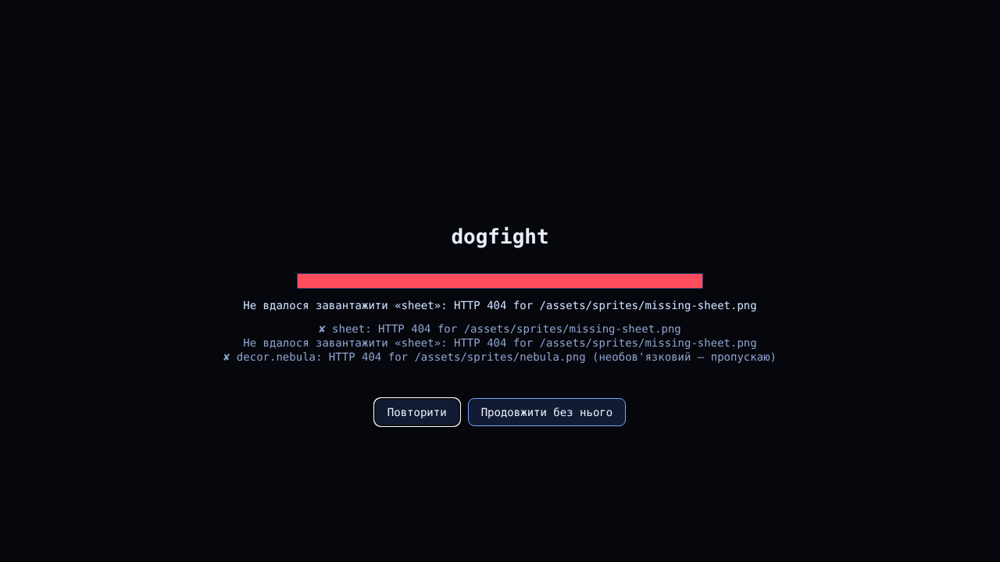

Решта: [`fail-timeout.png`](docs/lab-03/fail-timeout.png), [`fail-json.png`](docs/lab-03/fail-json.png), [`fail-abort.png`](docs/lab-03/fail-abort.png).

---

## Лаба 4 — Node.js: EventEmitter, streams, WebSocket-сервер

### Структура

```
package.json                 npm workspaces: client, server
scripts/dev.js               кросплатформний `npm run dev` (сервер + Vite)
client/                      усе з Лаб 1–3 + src/net/
  src/net/connection.js      WebSocket-клієнт: диспетчеризація за type, черга, reconnect з backoff
  src/net/chat-view.js       склад кімнати + чат поверх гри
  vite.config.js             proxy: /api, /health → :8080, /ws → ws://:8080
server/
  src/index.js               createGameServer(): http + ws + кімнати + журнали; SIGINT/SIGTERM
  src/config.js              читає й перевіряє process.env (PORT, HOST, LOG_DIR, ліміти…)
  src/http.js                node:http: статика (MIME, захист від traversal), /api/rooms, /api/replays, /health
  src/ws.js                  життєвий цикл сокета: join-таймаут, валідація, rate limit, heartbeat, slow client
  src/rooms.js               Room extends EventEmitter, RoomManager
  src/protocol.js            протокол v0: версія, валідатор, коди закриття
  src/ratelimit.js           token bucket
  src/log/matchlog.js        events → Readable(objectMode) → Transform(NDJSON) → файл, через pipeline
  src/log/replay.js          async-генератор: файл → рядки → події
  test/                      26 тестів node:test (unit + справжній сервер на випадковому порту)
  scripts/backpressure.js    вимір RSS під час повільного завантаження 200 МБ
  scripts/block-demo.js      затримка чату під час синхронного /api/slow
  scripts/crash-demo.js      падіння без слухача "error" і виправлення
```

### HTTP без фреймворку

- `GET /health`, `GET /api/rooms`, `POST /api/rooms` (тіло ≤ 4 КБ — і за `content-length`, і під час читання; JSON; `name` 1–32 символи; `arena` з білого списку → 201 / 400 / 413 / 422), `GET /api/replays`, `GET /api/replays/:id` (стрім), `GET /api/stats`.
- **Статика** з `client/dist` з MIME-типами. `safeJoin()` декодує URL, нормалізує, робить `resolve` і перевіряє, що шлях лишився **всередині** кореня. `/../../etc/passwd`, `%2e%2e/`, `..%2f`, NUL-байт і биті escape-послідовності відсікаються (тести в `unit.test.js`).
- **Конфіг** лише з `process.env` через `config.js`: невалідне значення валить процес на старті з назвою змінної. У dev — `node --env-file=.env` (файл створюється з `.env.example` при першому `npm run dev`).
- **Graceful shutdown** на `SIGINT`/`SIGTERM`: `server.close()` (нових не приймати) → кожному сокету `{type:"shutdown"}` + `close(1001)` → закрити кімнати → **дочекатися завершення pipeline журналів** → `exit(0)`. Якщо щось зависло — примусовий вихід через 10 с.

### Кімнати і WebSocket

- `Room extends EventEmitter` з `players: Map`, події `join` / `leave` / `chat` / `empty` + загальна `record` для журналу. `RoomManager` створює, шукає й видаляє кімнати і прибирає тимчасову кімнату, щойно вона емітить `empty`. Три кімнати за замовчуванням позначені `persistent`.
- **Життєвий цикл сокета** (`ws.js`): немає `join` за 5 с → `close(4000)`; кожне повідомлення проходить `parseClientMessage` (версія, тип, **лише дозволені поля**, типи й довжини; повертає результат, а не кидає) → помилка = лог + `close(4001)`; стан `{ player, room }` прив'язаний до сокета; `roster` на кожен join/leave, `chat` — усій кімнаті.
- **Heartbeat:** `ping` кожні 15 с, `pong` скидає лічильник; два пропущені → `terminate()`.
- **На кожному сокеті є слухач `"error"`** (див. нижче, чому це критично).
- **Клієнт** `connection.js`: `conn.on("roster", fn)` — диспетчеризація за `type`; повідомлення, надіслані до `open`, чекають у черзі; після розриву — перепідключення через `500 · 2^n · [0.5, 1.5)` мс (максимум 10 с) і повторний `join` на кожному `open`. Фатальні коди (4001, 4003, 4004, 4006) не повторюються.
- **Перевірка:** два вікна `/?room=alpha&name=Ann` і `/?room=alpha&name=Bob` бачать імена одне одного і чат (Playwright-скрипт + тест `two clients join one room…`).

| Код  | Причина                                    |
| ---- | ------------------------------------------ |
| 1001 | сервер вимикається                         |
| 1009 | кадр більший за `maxPayload` (4 КБ)        |
| 4000 | немає `join` за 5 с                        |
| 4001 | невалідне повідомлення                     |
| 4002 | перевищено rate limit                      |
| 4003 | кімната повна                              |
| 4005 | повільний клієнт (`bufferedAmount` > 1 МБ) |
| 4006 | немає такої кімнати                        |

### Журнали матчів як потоки

```
Room "record" ──► Readable({objectMode}) ──► Transform(obj → JSON + "\n") ──► createWriteStream(LOG_DIR/<room>-<час>.ndjson)
                                   └───────────────── pipeline() ─────────────────┘
```

- `roomRecordStream(room)` — Readable, у який події кімнати `push()`-аться; `room.close()` → `push(null)` → pipeline дописує файл і резолвить проміс (його й чекає shutdown).
- `readReplay(file)` — `async function*` поверх `readline` і `createReadStream`: файл будь-якого розміру, у пам'яті лише поточний шматок.
- `GET /api/replays/:id` — `pipeline(createReadStream(file), res)`. Id перевіряється регулярним виразом (жодних `/` і `..`).

### Доказ backpressure: RSS сервера

`node server/scripts/backpressure.js`: журнал 210 МБ, клієнт читає не швидше 20 МБ/с (аналог тротлінгу в DevTools), RSS сервера знімається з `/api/stats` кожні 200 мс; для кожного режиму — новий процес сервера.

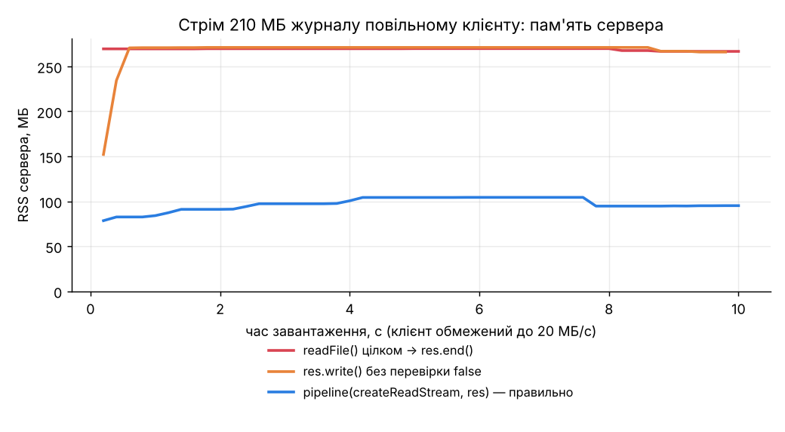

| Режим                                                    | RSS на старті | Пік RSS    |
| -------------------------------------------------------- | ------------- | ---------- |
| `pipeline(createReadStream(file), res)`                  | 78 МБ         | **104 МБ** |
| `stream.on("data", c => res.write(c))` (ігнорує `false`) | 152 МБ        | **271 МБ** |
| `res.end(await readFile(file))`                          | 267 МБ        | **270 МБ** |

З `pipeline` лінія пласка: файл читається рівно з тією швидкістю, з якою клієнт забирає дані, і в пам'яті лише кілька шматків по 64 КБ. Без backpressure диск віддає дані за долі секунди, `res.write()` повертає `false`, але читання не зупиняється — і весь файл осідає в буфері сокета. З `readFile` він у пам'яті з першої ж миті. (Антиприклади доступні лише з `ENABLE_DEBUG_ROUTES=1` через `?mode=nopipe|buffer`.)

**Де ще backpressure:** журнал матчу. Кімнату не можна «поставити на паузу», тож якщо диск не встигає, записи накопичуються в буфері Readable (`readableLength`). Для подій кімнати це байти на секунду — прийнятно; для знімків стану 30 разів/с (Лаба 5) їх у журнал треба буде проріджувати.

### Блокування event loop: `/api/slow`

`node server/scripts/block-demo.js` ([повний вивід](docs/lab-04/block-demo.txt)): Ann шле чат кожні 50 мс і міряє, коли повідомлення повертається до неї через сервер. Через 1 с інший клієнт тричі викликає `/api/slow` (синхронний busy-wait 300 мс):

```
GET /api/slow #1 at t=1001 ms took 340 ms
  t, ms   chat round-trip, ms
  955       1
 1025       2
 1075     266  ███████████████████████████
 1126     216  ██████████████████████
 1175     166  █████████████████
 1226     116  ████████████
 1276      66  ███████
 1326      15  ██
 1376     269  ███████████████████████████   ← другий /api/slow
 …
 1981       0
без блокування: медіана 0.9 мс; гірший під час /api/slow: 269 мс
```

«Пилка» — це event loop, що стоїть: повідомлення Ann лежать у буфері ядра, поки синхронний цикл тримає стек. Коли цикл закінчується, накопичені повідомлення обробляються одним залпом. Перше, надіслане одразу після старту блокування, чекає ~266 мс, кожне наступне на 50 мс менше. Постраждала кімната, яка не мала до `/api/slow` жодного стосунку: потік **один на всіх**.

**Фази event loop у Node (libuv):** timers (`setTimeout`/`setInterval`) → pending callbacks → idle/prepare → **poll** (I/O: сокети, файли; тут чекаємо) → **check** (`setImmediate`) → close callbacks. Між **кожним** колбеком — `process.nextTick` і мікрозадачі промісів. Синхронний код у будь-якому колбеку зупиняє всі фази для всіх з'єднань.

### Чому падає сервер: `"error"` без слухача

`node server/scripts/crash-demo.js` ([повний вивід](docs/lab-04/crash-demo.txt)): «нападник» шле кадр 64 КБ (більше `maxPayload` = 4 КБ), «гравець» мирно сидить у сусідній кімнаті.

```
===== БЕЗ слухача 'error' на сокеті =====
node:events:497
      throw er; // Unhandled 'error' event
RangeError: Max payload size exceeded
    at Receiver.haveLength (…/ws/lib/receiver.js:442:28)
--- /health після атаки: недоступний (ECONNREFUSED)
--- з'єднання невинного гравця: CLOSED
--- код виходу процесу: 1

===== З слухачем 'error' (як у коді сервера) =====
[ws] socket error 127.0.0.1: Max payload size exceeded
--- /health після атаки: 200 OK
--- з'єднання невинного гравця: OPEN
```

`EventEmitter.emit("error")` без жодного слухача **кидає** помилку. Вона відбувається в колбеку I/O, тож її нікому перехопити, і процес завершується з кодом 1, разом з усіма кімнатами. Виправлення — `socket.on("error", …)` на **кожному** сокеті (у `ws.js`). Рівноцінна пастка для промісів — необроблене відхилення: з Node 15 `--unhandled-rejections=throw` за замовчуванням так само завершує процес. Тому на сервері кожен `async`-обробник загорнутий у `try/catch` (`http.js`), а проміси журналів мають `.catch`.

### Захист від зловживань

| Механізм         | Де                         | Значення                                                                                                             |
| ---------------- | -------------------------- | -------------------------------------------------------------------------------------------------------------------- |
| Token bucket     | `ratelimit.js`, `ws.js`    | 30 повідомлень/с, сплеск до 60 → `close(4002)`                                                                       |
| `maxPayload`     | `new WebSocketServer(...)` | 4 КБ → `close(1009)`                                                                                                 |
| Ліміти           | `RoomManager`              | ≤ 50 кімнат (`POST` → 409), ≤ 8 гравців у кімнаті → `close(4003)`                                                    |
| Повільний клієнт | `send()` у `ws.js`         | `bufferedAmount` > 256 КБ — некритичне (чат) відкидається; `roster` / `welcome` ідуть завжди; > 1 МБ → `close(4005)` |

Усе це покрито тестами (`server/test/server.test.js`): flood → 4002, завеликий кадр → 1009, «мовчазний» клієнт (`autoPong: false`) → `terminate()`, після всіх атак `/health` → 200.

---

## Лаба 5 — Сервер рахує гру: передбачення, звірка і бінарний протокол

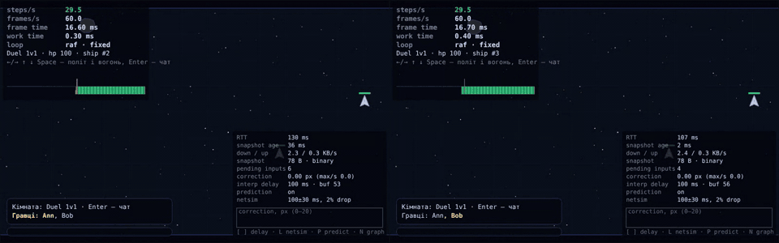

_20 секунд дуелі двох клієнтів, кожен із симульованими 100 ± 30 мс RTT і 2% втрат пакетів (`?lag=100&jitter=30&drop=2`). Ліворуч Ann, праворуч Bob; netgraph у правому нижньому куті._

### Структура

```
shared/                       третій workspace — імпортується і клієнтом, і сервером
  src/sim/                    симуляція (переїхала з client/src/sim)
  src/protocol/messages.js    протокол v1: типи, валідація, коди закриття, TICK_RATE
  src/protocol/snapshot.js    World → знімок (entityState, eventState, buildSnapshot)
  src/codec/binary.js         DataView-кодек: input і snapshot (специфікація — docs/protocol.md)
  src/codec/json.js           JSON-кодек для порівняння
  src/codec/index.js          інтерфейс Codec { encodeSnapshot, decodeSnapshot, encodeInput }
  src/determinism.js          worldHash() + еталонний сценарій
  src/arenas.js               конфіги арен (джерело правди для сервера)
  test/                       round-trip кодеків, детермінізм, «без DOM»
server/src/match.js           Match: авторитетний World на 30 Гц, черги команд, знімки
client/src/online.js          мережева гра: передбачення, звірка, інтерполяція, події
client/src/net/prediction.js  predictStep / reconcile — чисті функції
client/src/net/interpolation.js  SnapshotBuffer, інтерполяція з урахуванням тора
client/src/net/netgraph.js    RTT, вік знімка, байти/с, pending, корекції + спарклайн
client/src/net/connection.js  + бінарні кадри, лічильники байтів, ІНЖЕКТОР затримки/джитеру/втрат
client/determinism.html       той самий еталонний сценарій у браузері
```

Пакет `shared` підключено як `"@dogfight/shared": "*"` (npm workspaces створює symlink у `node_modules`). У `shared/` немає жодного звернення до DOM, `Buffer` чи `Date.now()`, тому Vite збирає його в бандл клієнта, а Node імпортує напряму.

### M1 — сервер рахує, «тупий» клієнт

- `Match` на кожну кімнату: `World.step(1/30)` **30 разів на секунду**. Таймер з **абсолютною ціллю**: тік _n_ плануємо на `start + n · 33.333 мс` через `setTimeout(…, target − now)`. Похибки окремих `setTimeout` не накопичуються, бо наступна ціль рахується від нуля, а не від фактичного часу попереднього тіку. `setInterval(33)` дав би 30.3 Гц і дрейф.
- **Перевантаження:** якщо тік спізнився більше ніж на інтервал, наздоганяємо до 3 тіків поспіль. Якщо відстали ще більше (процес стояв), зсуваємо «нуль» і рахуємо пропущені тіки в `skippedTicks` — без спіралі смерті.
- `/api/stats` віддає для кожного матчу тривалість тіку і запізнення. Після 20-секундної дуелі: **тік p50 0.30 мс / p99 2.47 мс** (бюджет 33.3 мс), **запізнення таймера p50 0.27 мс / p99 5.45 мс / max 8.9 мс**, `skippedTicks: 0`.
- Кожен знімок містить `tick` і `ack` — **`lastProcessedSeq` саме цього отримувача** (тому сервер кодує знімок окремо для кожного гравця).
- Клієнт шле команду з `seq` на **кожному** кроці симуляції (30/с).
- **Команди на сервері:** черга на гравця, **рівно одна команда за тік**. Якщо команда не прийшла вчасно, повторюємо попередню, але без пострілу; якщо черга довша за 6, викидаємо найстаріші. Так сервер застосовує ту саму послідовність кроків, що й клієнт.
- «Тупий» режим: `?predict=0` — свій корабель рухається лише з приходом знімків.

### M2 — передбачення і звірка

- **Передбачення:** на кожному кроці клієнт виконує `predictStep(state, cmd, 1/30)`, тобто **ту саму** `integrate()` з `shared/`, що й сервер, і показує результат одразу.
- **Буфер непідтверджених команд** `pending: [{seq, cmd}]`. На кожному знімку `reconcile()` (чиста функція): серверний стан мого корабля → викинути `seq ≤ ack` → програти решту → різниця з тим, що було на екрані, = **корекція**.
- **Згладжування:** корекцію додаємо до візуального зсуву, який згасає як `e^(−3t/100 мс)`, тобто за ~100 мс. Більше 150 px (респавн) — без згладжування.
- **Свої кулі** передбачаються локально з тією самою логікою cooldown, що в `Ship.fire()`. Кожна серверна куля несе `seq` вводу, що її створив: клієнт зв'язує локальну кулю з серверною за `seq` і прибирає локальну, щойно серверна зникла (влучила). Кулю, якої сервер так і не створив (корабель уже був знищений), прибираємо через `RTT + 250 мс`.

**Результати при 100 мс RTT** (headless Chromium, однаковий 8-секундний маршрут із газом, поворотами і стрільбою):

| Режим                                            | Натиснув газ → корабель зрушив       | Корекцій за 8 с              | Макс. корекція                   |
| ------------------------------------------------ | ------------------------------------ | ---------------------------- | -------------------------------- |
| без передбачення (`?predict=0`)                  | **150 мс** (≈ RTT + тік + кадр)      | —                            | —                                |
| з передбаченням                                  | **34 мс** (наступний крок симуляції) | **0–2**                      | 0.00 px (Float32-шум ~5·10⁻⁵ px) |
| з передбаченням, 100 ± 30 мс, 2% втрат           | 25–42 мс                             | 0–4                          | ≤ 1.5 px                         |
| **`Math.random()` у `integrate` (`?chaos=1.5`)** | 33 мс                                | **225** (майже кожен знімок) | **4.5 px за секунду**            |

| Без передбачення                   | З передбаченням                          |
| ---------------------------------- | ---------------------------------------- |
| 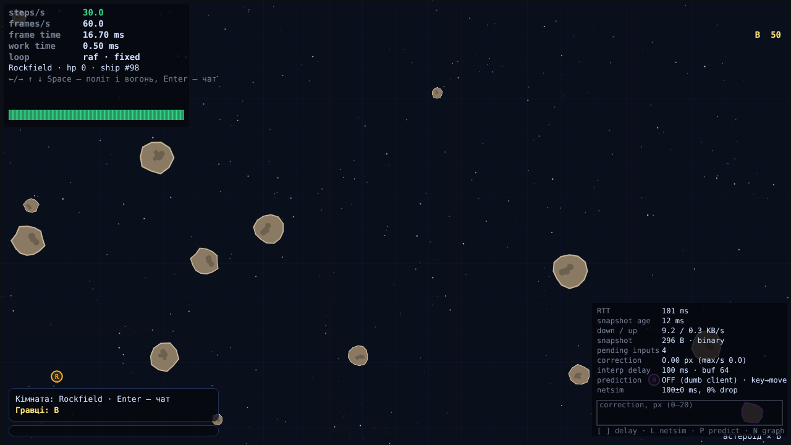 | 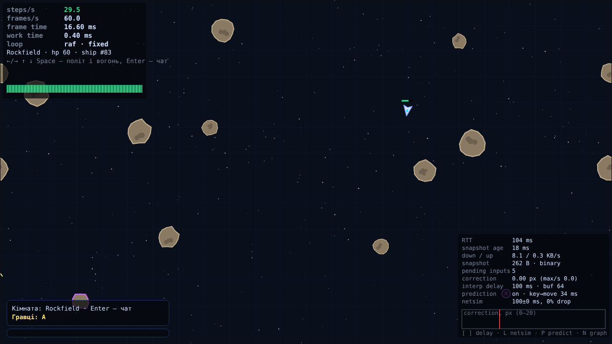 |

У відкритому космосі корекції нульові: клієнт і сервер виконують ідентичні кроки над ідентичними даними. Сплески дають лише події, яких клієнт не передбачає: зіткнення з астероїдом (відскок рахує тільки сервер), влучання, смерть.

**Експеримент «зламаний детермінізм».** `?chaos=1.5` вмикає в `integrate()` множник тяги `1 + (Math.random() − 0.5) · 1.5`, лише на клієнті. Клієнт і сервер отримують різні випадкові числа, тому **кожен** знімок дає корекцію (225 за 8 с), а корабель на екрані постійно «смикається». Спарклайн у netgraph:


Виправлення: прибрати `Math.random()` із симуляції. Уся випадковість світу йде з `world.rng` (mulberry32 з зерном), а прапорець `chaos` за замовчуванням дорівнює 0.

### M3 — інтерполяція і другий гравець

- Віддалені сутності показуються **в минулому**: `renderTime = now − offset − interpDelay`. `offset` — оцінка різниці годинників: швидко спадає, якщо знімок прийшов «раніше», і повільно росте, якщо пізніше, тобто сприймає джитер як шум. Між двома знімками навколо `renderTime` позиції інтерполюються **через край тора** коротшим шляхом, кути — `lerpAngle`.
- **За замовчуванням `interpDelay` = 100 мс** (2 інтервали по 33 мс + 33 мс запасу на джитер). Змінюється наживо клавішами **[** / **]** з кроком 16 мс і видно в netgraph. Якщо `renderTime` новіший за останній знімок, netgraph показує `STARVED` — сутності замирають (екстраполяції немає).
- **Поява/зникнення:** сутність є лише в ранньому знімку → малюємо її в останній відомій позиції до кінця інтервалу; лише в пізньому → не малюємо, доки час не дійде до нього. Без цього куля «спалахувала» б на мить у точці пострілу або зникала до влучання.
- **Події** зі знімків (постріл, влучання, вибух, підбір, очки) ставляться в чергу і програються, коли `renderTime` доходить до їхнього тіку. Тоді звук вибуху збігається з картинкою, а не випереджає її на 100 мс. Свої постріли звучать одразу, з передбачення.
- **Перевірка:** двоє клієнтів, 100 ± 30 мс, 2% втрат, 20 с бою (GIF угорі). У netgraph RTT 118–123 мс, корекцій 0 і 3 за 20 с, натискання → рух 25–42 мс.

**Чому втрати майже не дають корекцій:** кожне повідомлення `input` несе **три** останні команди, а сервер відкидає вже бачені `seq`. Щоб сервер «пропустив» команду, мають загубитися три пакети поспіль (0.02³ ≈ 8·10⁻⁶). Втрачений знімок просто означає, що інтерполяція бере сусідній.

**Інжектор мережі** (`connection.js`) затримує кожне повідомлення на `latency/2 ± jitter` в кожен бік і викидає частку `drop` **ненадійних** повідомлень (знімки й input; `join`, чат і `pong` не губляться). Порядок доставки зберігається, як у TCP. Пресети перемикає клавіша **L**.

### M4 — бінарний протокол

Специфікація — [`docs/protocol.md`](docs/protocol.md): little-endian, версія в байті 5, байт 0 — тип, байти 1–4 — `tick` (u32), сутність = `id` u16, `kind` u8, `x`/`y` f32, `angle` i16 у 1/1000 рад, далі доповнення за типом. Клієнт ставить `ws.binaryType = "arraybuffer"`; JSON-кодек лишився за прапорцем `?codec=json`.

**Round-trip тести** (`shared/test/shared.test.js`): `decode(encode(x)) ≈ x` у межах квантування; розмір кадру точно за формулою специфікації; `tick = 1` на дроті — `01 00 00 00`; NaN, від'ємний tick чи `hp > 255` при кодуванні → `CodecError`; обрізаний кадр, зайвий байт, чужа версія чи невідомий `kind` при декодуванні → **лише** `CodecError`, жодних інших винятків.

**JSON проти DataView** (`node server/scripts/codec-bench.js`: 4 гравці, арена classic, 60 с гри при 30 Гц = 1800 знімків, у середньому 23 сутності, максимум 30; [вивід](docs/lab-05/codec-bench.txt)):

| Кодек               | Байт/знімок (сер. / макс.) | KB/s вниз на клієнта | KB/s вгору на клієнта | encode+decode, мкс |
| ------------------- | -------------------------- | -------------------- | --------------------- | ------------------ |
| JSON                | 3267 / 4176                | 95.7                 | 5.81                  | 58.9               |
| Binary (`DataView`) | **469 / 591**              | **13.7**             | **0.29**              | **29.3**           |
| виграш              | **×7.0**                   | ×7.0                 | ×20                   | ×2                 |

Вгору виграш ×20, бо команда — 1 байт замість `{"turn":0,"thrust":true,"brake":false,"fire":false}`. У живій дуелі (2 гравці, 9–12 сутностей) netgraph показує 190–230 байт на знімок і ~6–7 KB/s вниз.

### Мережевий код — підсумок

**Три проблеми.** (1) **Затримка:** між натисканням і відповіддю сервера минає RTT. Без компенсації керування відчувається як «ватне»: 150 мс при RTT 100. (2) **Узгодженість:** кожен клієнт бачить свою версію світу, і вони мають сходитись до однієї. (3) **Чітинг:** клієнту не можна довіряти позицію, здоров'я чи влучання.

**Як вирішено.** Чітинг і узгодженість — **авторитетний сервер**: клієнт шле лише _намір_ (1 байт команд), сервер перевіряє його (`validateInput`, rate limit) і сам рахує фізику, влучання, очки. Затримка свого корабля — **передбачення + звірка** (34 мс замість 150). Затримка й джитер чужих — **інтерполяція в минулому** зі 100 мс буфера.

**Баг детермінізму, який я зловив.** Експеримент з `Math.random()` описаний вище. Справжній баг трапився в Лабі 2: два прогони світу в **одному** процесі давали різні результати, бо `Entity.#nextId` — статичний лічильник на весь процес, і id (а з ними порядок у `Map` і ключі рахунку) зсувались. Для еталонного сценарію тепер є `Entity.resetIds()`. На сервері кожен матч має свої id, а в мережу йдуть молодші 16 біт (колізія можлива лише якщо сутність живе, поки народжуються 65 536 інших).

**Компроміс затримки інтерполяції.** Менша затримка — чужі кораблі ближчі до «тепер» і влучати легше, але кожен запізнілий знімок лишає інтерполяцію без «наступного» знімка (`STARVED`), і сутності на мить замирають. Більша — плавно навіть при поганій мережі, але цілишся туди, де ворог був 100+ мс тому. Заміряно: 100 ± 30 мс RTT, 2% втрат, 10 с, ~640 кадрів, по 2 прогони:

| `interpDelay`       | кадрів `STARVED`  |
| ------------------- | ----------------- |
| 33 мс (1 інтервал)  | 63–66%            |
| 66 мс (2 інтервали) | 10–11%            |
| **100 мс (обрано)** | **0.2%** (1 кадр) |
| 133 мс              | 0%                |

Обрано **100 мс ≈ 3 тіки**: на «підручникових» 2 інтервалах кожен десятий кадр без даних (джитер ±30 мс плюс втрачені знімки), а 133 мс не дають помітного виграшу і додають ще 33 мс «минулого». Повна компенсація цієї затримки при влучаннях — лаг-компенсація на сервері (Stretch, не зроблено).

**Обмеження.** Детермінізм перевірено між V8 у Node і Chromium (однаковий хеш `15496668` еталонного сценарію). `Math.sin/cos/exp` у різних рушіях (SpiderMonkey у Firefox, JavaScriptCore у Safari) можуть відрізнятись в останньому біті. Це дасть мікроскопічні корекції, але не розсинхронізацію: сервер однаково авторитетний.

---

## Лаба 6 — TypeScript для протоколу і симуляції

### Налаштування

- `tsconfig.base.json`: `strict`, **`noUncheckedIndexedAccess`**, `verbatimModuleSyntax`, `erasableSyntaxOnly`, `noImplicitOverride`, `allowImportingTsExtensions`, `noEmit`. Кожен пакет розширює базовий: `shared/` і `server/` — `module: NodeNext`, `client/` — `ESNext` + `moduleResolution: bundler` + DOM.
- `npm run typecheck` у корені запускає `tsc --noEmit` у кожному workspace; у CI (`.github/workflows/ci.yml`) — `npm ci → typecheck → check (Biome) → test`.
- **Сервер виконує `.ts` напряму:** Node 22.18+ сам зрізає типи (`node src/index.ts`), без `tsx` і кроку збирання. Тому заборонено все, що не можна просто стерти: `enum`, `namespace`, параметри-властивості (`erasableSyntaxOnly` це перевіряє), а імпорти пишуться з `.ts`.
- **Vite не перевіряє типи** (лише стирає їх через esbuild), тому `npm run build -w client` = `tsc --noEmit && vite build`.
- Тести переїхали на **Vitest** (`shared/`, `server/`): 64 тести; детермінізм перевіряє хеш еталонного сценарію в Node і в браузері (`/determinism.html`), обидва дають `63c4ea8a`.

**Підсумок:** 0 помилок `tsc` у трьох пакетах, **0 `any`**, **2 приведення `as`** (ліміт — менше 5), обидва з коментарем:

| #   | Де                                        | Навіщо                                                                                                                                        |
| --- | ----------------------------------------- | --------------------------------------------------------------------------------------------------------------------------------------------- |
| 1   | `shared/src/types.ts` → `brandInt()`      | конструктор брендованого типу: _єдине_ місце, де `number` стає `EntityId`/`PlayerId`, і то після перевірки `Number.isInteger(n) && n >= 0`    |
| 2   | `shared/src/sim/world.ts` → `makeEvent()` | `{ type: K, detail: WorldEvents[K] }` для узагальненого `K` компілятор не «розподіляє» на об'єднання `WorldEvent`, хоча тип справді коректний |

Решта місць, де в JS були б приведення, переписані: `querySelector` → `$(root, selector, HTMLInputElement)` з `instanceof`; `document.getElementById("game")` → перевірка `instanceof HTMLCanvasElement`; `JSON.parse` → `unknown` + zod; `catch (err)` → `unknown` + звуження.

### Протокол: одна схема, один тип, обидва напрями

`shared/src/protocol.ts` — єдине джерело правди: zod-схеми для **кожного** повідомлення клієнт→сервер і сервер→клієнт і для знімка; TypeScript-типи _виводяться_ з них (`z.infer`):

```ts
export const ClientMessageSchema = z.discriminatedUnion("type", [join, chat, ping, input, leave]);
export type ClientMessage = z.infer<typeof ClientMessageSchema>;

export function parseClientMessage(raw: unknown): Result<ClientMessage>; // ніколи не кидає
export function parseServerMessage(raw: unknown): Result<ServerMessage>; // клієнт теж не довіряє мережі
```

- Рукописний валідатор Лаби 4 видалено. Сервер на `{ ok: false }` пише в журнал і закриває сокет із кодом 4001, як і раніше.
- **Бінарний кодек** типізований: `encodeSnapshot(snap: Snapshot): ArrayBuffer` перевіряє діапазони (u8/u16/u32, скінченні float), `decodeSnapshot` перевіряє версію, довжину, `kind` і тип події і на будь-яких байтах повертає або `Snapshot`, або `CodecError`. Розшифровані команди з бінарного input проходять ту саму zod-схему `CommandSchema`, що й JSON.
- `interface Codec { encodeSnapshot; decodeSnapshot; encodeInput }` — дві реалізації (`binaryCodec`, `jsonCodec`). Сервер тримає кодек кожного гравця як `Codec`, не знаючи, який саме.
- **Кожен `switch` по `type`/`kind` закінчується `assertNever(x)`** (`default: const _: never = x`): `Connection.#dispatch`, `ws.ts handle()`, `entityState()`, `eventState()`, `drawWorld()`, `toRenderEntity()`, `emitEvent()`, кодек. Новий тип повідомлення без гілки — помилка компіляції, а не тихе ігнорування.
- **Конфіг** — zod-схема над `process.env` з типами і значеннями за замовчуванням (`z.coerce.number().int().min(…).default(…)`), порожні рядки → «не задано». Невалідне значення валить старт із назвою змінної.
- **Типізовані події:** `class Room extends EventEmitter<RoomEvents>` (generic з `@types/node`), `RoomManager extends EventEmitter<{ created: [Room]; deleted: [Room] }>`, а в клієнті й симуляції — власна `Bus<M>` поверх `EventTarget`: `World extends Bus<WorldEvents>`, `Lobby extends Bus<LobbyEvents>`, `Connection extends Bus<ConnectionEvents>`.

### Рамка (фреймворк): не додавав — і чому

Лобі (~170 рядків) і HUD/чат (~150) працюють на `Bus<…>` + DOM. Типізовані події дали саме те, за чим зазвичай беруть фреймворк: `lobby.on("rooms", rooms => …)` знає тип `rooms`, відписка — один `AbortController`. Реактивності, діфінгу дерева чи роутера цьому UI не потрібно: список кімнат перемальовується раз на 5 с через `replaceChildren`, чат додає рядок. Canvas і ігровий цикл лишаються ванільними за умовою курсу.

**Ціна, яку я реально заплатив за типи на межі, — zod у клієнті:** головний бандл виріс з **49.0 КБ / 19.7 КБ gzip** (Лаба 5) до **150.5 КБ / 48.3 КБ gzip**. React + ReactDOM додали б ще ~45 КБ gzip без жодної нової властивості. Якщо розмір стане проблемою, перший крок — `zod/mini` у клієнті (та сама схема, менший рантайм), а не відмова від валідації.

### What TypeScript found

1. **Манекен повертав на ±0.6.** `dummyPilot` віддавав `turn: 0.6`, а `Command.turn` — це `-1 | 0 | 1`. У мережі zod відкинув би таку команду, а бінарний кодек упакував би `0.6 + 1` у 2 біти як сміття. Боти Лаби 7 використовують цю ж функцію, тож тут це вистрілило б.
2. **Підсилювачі на сервері з'являлись удвічі рідше.** `defaultDirector(world, _dt)` рахував інтервал як `tick % (60 · pickupEvery)`: тіки вважались 60-герцовими, а сервер іде на 30 Гц. Параметр `dt` типу `Director` був позначений невикористаним (`_dt`); коли тип змусив про нього згадати, баг став очевидним. Тепер `round(pickupEvery / dt)`. Через це змінився еталонний хеш (`15496668` → `63c4ea8a`, підсилювач тепер з'являється на 180-му тіку).
3. **Клієнт не перевіряв жодного повідомлення сервера.** `JSON.parse(e.data)` повертав `any`, і далі код вірив у будь-яку форму. Тепер `unknown` → `parseServerMessage` (zod), а невалідний кадр пишеться в консоль і відкидається.
4. **Офлайн-кулі без `seq`.** `Ship.fire()` записує `bullet.seq = this.command.seq`, але офлайн-гра клала в `World.step` команди з `readCommand()`, де `seq` немає. `SeqCommand` зробив поле обов'язковим.
5. **`readCommand()` повертав `turn: number`.** `(right ? 1 : 0) - (left ? 1 : 0)` має тип `number`, а не `-1 | 0 | 1`. Переписано так, що тип виводиться як літеральний.
6. **Після `close()` сервер продовжував обробляти буфер сокета.** Типізований тест із точними лічильниками відмов показав `rate_limit: 16` замість `1`: флудер, якого вже закрили, «набивав» метрики і викликав `close()` ще 15 разів. Тепер повідомлення після `close()` ігноруються (`readyState !== OPEN`).
7. **`noUncheckedIndexedAccess`** знайшов кілька місць, де індекс міг дати `undefined`: `url.split("?")[0]` у middleware Vite, `stats.history[i]` у HUD, `pts[0][0]` у малюванні астероїда, `items[0]` у буфері знімків. Справжнього падіння жодне не дало б, але тепер кожне явно обробляє порожній випадок.
8. **Відписка від подій `Connection` у `chat-view`** робилась парою `addEventListener`/`removeEventListener` з різними об'єктами-функціями. Тепер `conn.on()` повертає функцію відписки, і всі підписки знімаються однаково.

### Три типи, які варто пояснити JS-розробнику

**1. Брендовані id** (`shared/src/types.ts`):

```ts
type EntityId = number & { readonly [brand]: "EntityId" };
type PlayerId = number & { readonly [brand]: "PlayerId" };
```

У рантаймі це звичайні числа (бренд — лише тип, `[brand]` ніколи не існує). Але `room.leave(ship.id)` — помилка компіляції: функція чекає `PlayerId`, а `ship.id` — `EntityId`. До TypeScript корабель #3 і гравець #3 були взаємозамінні, і переплутати їх у `Match.removePlayer` було б дуже легко. Отримати бренд можна лише через `EntityId(n)` / `PlayerId(n)`, які перевіряють, що це невід'ємне ціле.

**2. `Bus<M>` — назва події пов'язана з формою її даних** (`shared/src/bus.ts`):

```ts
class Bus<M extends object> extends EventTarget {
  emit<K extends keyof M & string>(type: K, detail: M[K]): void
  on<K extends keyof M & string>(type: K, fn: (detail: M[K]) => void): () => void
}
class World extends Bus<WorldEvents> { … }   // WorldEvents = { fired: {...}; hit: {...}; … }
```

`K` — це **конкретна** назва (`"scored"`), а `M[K]` — тип саме її payload. `world.on("scored", d => d.total)` — `d` виведено автоматично; `world.emit("scored", { points: 5 })` без `total` — помилка; `world.on("scroed", …)` — помилка. Один і той самий `attachAudio(bus: Bus<WorldEvents>)` приймає і офлайн-`World`, і мережеву шину клієнта.

**3. Знімок як дискриміноване об'єднання, виведене з zod** (`shared/src/protocol.ts`):

```ts
const EntityStateSchema = z.discriminatedUnion("kind", [ShipStateSchema, BulletStateSchema, …]);
type EntityState = z.infer<typeof EntityStateSchema>;
// = { kind: 1; vx; vy; hp; … } | { kind: 2; owner; seq; homing; … } | …
```

Схема — і перевірка в рантаймі (JSON-кодек, `parseServerMessage`), і тип для компілятора. Усередині `switch (e.kind) { case KIND.ship: … }` TypeScript **знає**, що в `e` є `hp` і `vx`, а в `case KIND.bullet` — `owner` і `seq`. Бінарний декодер будує ті самі об'єкти, тож для решти коду немає різниці, звідки прийшов знімок. Нове поле в схемі ламає компіляцію всюди, де його треба заповнити (`entityState()`, кодек).

---

## Лаба 7 — Двигун, продуктивність і тести

Середовище всіх вимірів: хмарний Linux-контейнер, **2 vCPU**, Node **22.22**, Chromium **141 headless** (Playwright), вікно 1280×720. Числа на звичайному ноутбуці будуть іншими — методика та сама, скрипти в репозиторії.

### M1 — тести

```bash
npm test              # Vitest у трьох пакетах: shared 60 · server 58 · client 17 = 135 тестів
npm run test:coverage # покриття shared/: 97.96 % рядків, 92.6 % гілок (поріг у vitest.config.ts — 85 %)
```

- **Юніт:** `Vector2`, `integrate`, колізії (дотик, перекриття, промах, **тунелювання швидкої кулі** — було, виправлено _swept_-перевіркою відрізка руху), детермінізм `World.step` (дві копії світу → однаковий хеш), звірка (`reconcile`) як чиста функція, token bucket, акумулятор циклу і heartbeat на **фейкових таймерах** (`vi.useFakeTimers()`).
- **Властивості (fast-check, 8 тестів)** у `shared/test/properties.test.ts`: round-trip бінарного кодека в межах квантування; довжина кадру = формула зі специфікації; довільні байти → тільки `CodecError`, ніколи інший виняток; корабель лишається в арені після 1000 випадкових команд; `parseClientMessage` приймає кожне згенероване валідне повідомлення і відкидає кожну мутацію. Окремий тест у `sim.test.ts` перевіряє, що просторовий хеш знаходить рівно ті самі пари, що й O(n²).

### M2 — e2e і CI

- `e2e/multiplayer.spec.ts` (Playwright, `webServer` збирає клієнт і піднімає сервер на :8095): **два контексти браузера** в одній кімнаті → однаковий склад; Ann летить → Bob бачить зміщення її корабля < 500 мс; чат доходить; лобі показує кімнати, повна кімната відмовляє. `npm run e2e`.
- `.github/workflows/ci.yml`: job **check** (`npm ci → typecheck → Biome → test:coverage`) і job **e2e** (`build → playwright install chromium → e2e`, звіт як артефакт при падінні).
- Лінт — **Biome** з `nursery/noFloatingPromises` і `noMisusedPromises` як помилка (аналог `@typescript-eslint/no-floating-promises`): проміс, який ніхто не чекає і не обробляє, — помилка CI. Там, де результат справді не потрібен , стоїть явний `void` (`lobby.refresh()` — помилки обробляє сам метод, `done.finally(...)` у сервері). `npm run check` — 0 помилок.

### M3 — профіль клієнта: до і після

Інструментація: `performance.measure` для `simulate`, `render`, `decode`, `reconcile` (`client/src/perf.ts`, увімкнути `?perf`). Профіль знімає `scripts/profile-client.mjs`: 30 с бою в кімнаті з **8 серверними ботами**, вогонь без перерви; через Chrome DevTools Protocol одночасно CPU-профіль, вибірка алокацій купи (разом із зібраними об'єктами) і траса GC. Збірка для профілю — `PROFILE=1 npm run build` (без мініфікації, щоб у профілі були імена функцій).

```bash
PROFILE=1 npm run build
node scripts/profile-client.mjs before            # → docs/lab-07/profile-before.json
THROTTLE=4 node scripts/profile-client.mjs after-x4   # CPU ×4 повільніше — «слабкий ноутбук»
```

| 30 с, 8 ботів                       | до                 | після              | до, CPU ×4         | після, CPU ×4      |
| ----------------------------------- | ------------------ | ------------------ | ------------------ | ------------------ |
| інтервал кадру p50 / p95 / p99, мс  | 16.7 / 16.7 / 16.8 | 16.7 / 16.7 / 16.8 | 16.7 / 33.3 / 33.4 | 16.7 / 33.3 / 33.4 |
| найдовший кадр, мс                  | 33.4               | **16.8**           | 150                | 116.7              |
| кадрів > 20.7 мс                    | 1                  | **0**              | 200                | 151                |
| `render` p50 / p99, мс              | 0.7 / 2.5          | 0.4 / 2.3          | —                  | 0.6 / 5.7          |
| CPU головного потоку (без idle), мс | 1560               | **807** (−48 %)    | 5273               | 3172 (−40 %)       |
| виділено пам'яті (вибірка), МБ      | 94.5               | **47.4** (−50 %)   | 86.0               | 46.3               |
| GC minor: кількість / сумарно, мс   | 26 / 28.2          | 14 / 21.0          | 20 / 78.9          | 13 / 57.3          |
| GC major: кількість / сумарно, мс   | 12 / 36.4          | 10 / 32.7          | 10 / 118.5         | 9 / 104.3          |

**Топ алокаторів до:** ітератори (`next`, 13.4 МБ), `toRenderEntity` (12.4 МБ — новий об'єкт на кожну сутність щокадру), `interpolateEntities` (10.7 МБ — новий масив і `{...eb}` на кожну сутність), `drawWorld` (10 МБ). **Після:** ітератори 8.2 МБ, `drawWorld` 7.0, `decodeSnapshot` 5.6 (знімок 30 разів/с — це «корисна» алокація), `drawHud` 3.2.

**Топ self time до:** `fillText` 8.4 %, `arc` 7.3 % (≈400 зірок фону щокадру), GC 6.9 %, `fill` 5.4 %. **Після:** GC 9.8 %, `fillText` 8.2 %, `requestAnimationFrame` 7.6 %, `drawImage` 7.4 % (спрайти).

Flame graph (згенеровано з `.cpuprofile` скриптом `scripts/flamegraph.mjs`; самі профілі — у `docs/lab-07/*.cpuprofile`, відкриваються в DevTools → Performance):

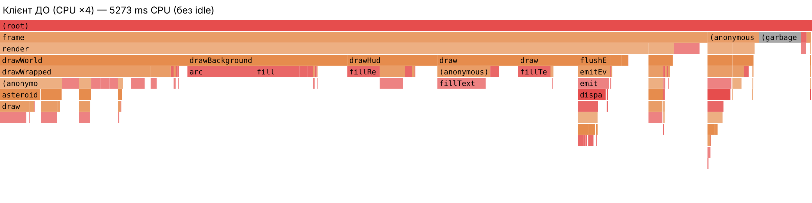
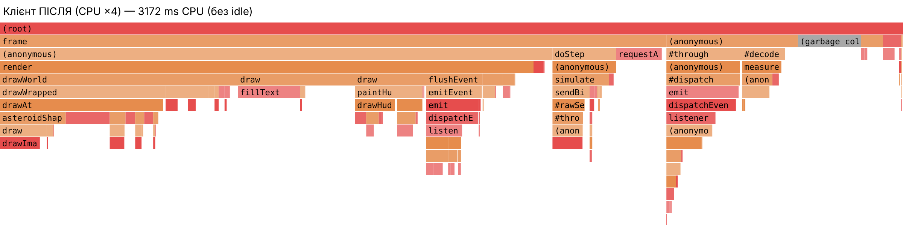

**Що виправлено — у порядку виміряного впливу:**

1. **Фон.** Сітка і зорі малювались щокадру (~400 `arc`+`fill`). Тепер фон малюється один раз у позаекранний canvas і стає **CSS-фоном** полотна; щокадру — лише `clearRect`. Проміжна версія (`drawImage` кешу щокадру) під CPU ×4 зробила `drawImage` топ-1 (30 %) — повноекранна копія пікселів теж дорога. Тому остаточний варіант — віддати складання шарів компoзитору.
2. **HUD і netgraph** — окремі `<canvas>`-накладки поверх гри (`client/src/render/layer.ts`), перемальовуються 10 разів на секунду. Текст (`fillText`) — найдорожча 2D-операція, а цифри, що змінюються 60 разів/с, однаково не прочитати.
3. **Рендер без алокацій у кадрі** (`client/src/online.ts`): `forEachInterpolated` замість `interpolateEntities` (колбек замість масиву нових об'єктів); **пул** об'єктів рендера за id сутності (створюється один раз, далі лише оновлюються поля; зниклі прибираються раз на секунду); свій корабель і передбачені кулі — сталі об'єкти; `lerpPos(..., out)` і `drawWrapped` пишуть у scratch-об'єкт замість `{x, y}` на кожен виклик.
4. **Буфер знімків 64 → 12** (2 с → 400 мс, більше за максимальну затримку інтерполяції). Знімки, що жили 2 с, переживали два scavenge і переходили в старе покоління.

**Ціль «0 major GC і p99 < 16.7 мс» — чесно:** на нативній швидкості після оптимізацій **жодного кадру довше 16.8 мс** за 30 с (до — був один на 33 мс). p99 інтервалу rAF не може бути меншим за 16.7 мс на 60-герцовому дисплеї — це період vsync; тому важливіше, що _робота_ кадру (`render` p99 2.3 мс + `simulate`) займає ~15 % бюджету. **Major GC лишились** (10 за 30 с, у середньому 3.3 мс кожен) — це інкрементальне маркування старого покоління, яке V8 розносить по кадрах; жоден не дав пропущеного кадру. Під CPU ×4 гра все ще пропускає кадри: тепер упирається не в GC, а в `fillText` (табло, імена) і спрайти. Наступні кроки, якщо треба: текст імен у кеш-спрайти, ітерація по масиву замість `for…of` по `Map` у декодері.

### M3 — профіль сервера

`node --cpu-prof` під навантаженням 64 клієнти (`NODE_OPTIONS="--cpu-prof --cpu-prof-dir=/tmp/cpuprof" NS=64 node server/scripts/loadtest.ts`, підсумок — `node scripts/cpuprofile-top.mjs <файл>`; збережено в `docs/lab-07/server-profile-64.txt`):

- Топ self time — **`writev` (15 %)**, тобто відправка байтів у сокети; далі GC 8 %, `Match.tick` 2.7 %, `Vector2` 1.6 %, `spatialHashCollisions` 1.4 %. Симуляція — не гаряча точка, мережа — так.
- **Колізії:** у `Match` тепер просторовий хеш (комірки 96 px) замість O(n²); `COLLISIONS=naive` повертає старий варіант для порівняння. Tick p99 при 128 гравцях: **10.17 → 5.67 мс** (і при цьому в прогоні з хешем у світі було більше сутностей: 272 проти 199).
- **Кодування знімка один раз на тік**, а не на кожного гравця: усі отримують однаковий бінарний кадр, відрізняється лише `ack` (u32 за зсувом 6) — копія буфера і запис 4 байтів (`SNAPSHOT_ACK_OFFSET`).
- `/api/stats` віддає `elu` (`performance.eventLoopUtilization()` з попереднього виклику) і `rss`.

### M4 — боти, воркер, навантаження

**Боти** (`server/src/bots.ts`): переслідують найближчий корабель, ухиляються від астероїдів, стріляють з упередженням. Подають команди через **той самий** `match.onInput(player, seq, cmds)`, що й люди, тому сервер їх не розрізняє. `POST /api/rooms/:id/bots {"count": 8}`, `DELETE` — прибрати.

**Воркер — експеримент, рішення: NO-GO.** `server/scripts/worker-bench.ts` крутить ту саму симуляцію (крок + знімок + кодування) у головному потоці і у `worker_threads` з передачею `ArrayBuffer` (transfer, без копії), 600 тіків:

| кораблів | у головному потоці p50 / p99, мс | worker: головний потік зайнятий p50, мс | worker: затримка кадру p50 / p99, мс |
| -------- | -------------------------------- | --------------------------------------- | ------------------------------------ |
| 8        | 0.15 / 4.36                      | 0.004                                   | 0.14 / 3.32                          |
| 64       | 0.37 / 2.48                      | 0.012                                   | 0.58 / 6.34                          |
| 128      | 0.82 / 3.08                      | 0.011                                   | 1.07 / 6.43                          |
| 256      | 1.85 / 7.92                      | 0.018                                   | 2.82 / 11.12                         |

Воркер справді звільняє головний потік, але додає затримку (p99 гірший у 1.4–2.6 раза), а виграш — максимум 1.8 мс із бюджету 33 мс. Профіль показує, що головний потік зайнятий записом у сокети, а не симуляцією, і воркер цього не змінить. Тому симуляція лишається в головному потоці; скрипт — у репозиторії як доказ.

**Навантажувальний тест** (`server/scripts/loadtest.ts`): N справжніх WebSocket-клієнтів (`ws`, бінарний кодек) в одній кімнаті, інпут 30 Гц (газ/поворот/вогонь випадково), сервер — окремий процес на кожне N, 3 с прогріву + 12 с виміру. Генератор навантаження працює на тих самих 2 vCPU, тож цифри песимістичні.

| N   | сутностей (grid / naive) | tick p50, мс | tick p99 grid, мс | tick p99 naive, мс | jitter p99, мс | ELU   | RSS, МБ | вихід, МБ/с |
| --- | ------------------------ | ------------ | ----------------- | ------------------ | -------------- | ----- | ------- | ----------- |
| 8   | 33 / 34                  | 0.49         | 2.43              | 1.27               | 1.13           | 0.033 | 107     | 0.2         |
| 32  | 94 / 81                  | 0.91         | 2.92              | 4.87               | 1.16           | 0.048 | 122     | 1.9         |
| 64  | 159 / 132                | 1.42         | 4.09              | 6.33               | 1.33           | 0.074 | 126     | 6.6         |
| 128 | 272 / 199                | 2.49         | 5.67              | 10.17              | 1.24           | 0.129 | 149     | 22.6        |
| 192 | 343                      | 3.86         | 10.26             | —                  | 1.15           | 0.198 | 158     | 45.2        |
| 256 | 404                      | 5.68         | 17.92             | —                  | 1.12           | 0.290 | 166     | 75.1        |


**Ємність.** За CPU бюджет тіку 33 мс не перевищено навіть при 256 гравцях в одній кімнаті (p99 17.9 мс; екстраполяція дає межу ≈ 330–350). Але **справжня межа — мережа:** трафік росте як N² (кожен з N отримує знімок з ~N сутностей): 128 гравців = 22.6 МБ/с ≈ 180 Мбіт/с, 256 — 75 МБ/с ≈ 600 Мбіт/с. На типовому VPS зі 100 Мбіт/с ємність однієї кімнати ≈ **90 гравців**; при 8 гравцях на кімнату (як у грі) — це ≈ 50 кімнат на процес, і там уже знову обмежує CPU. Що дало б більше: area-of-interest (слати лише сутності поблизу), дельта-знімки.

### Reflection — тези до захисту

1. **Конвеєр V8:** парсер → AST → **Ignition** (байткод, одразу виконується і збирає типи) → **Sparkplug/Maglev** (швидкий не-оптимізуючий/середній JIT) → **TurboFan** (оптимізований машинний код, спеціалізований під побачені типи). Оптимізація — коли функція «гаряча»; деоптимізація — коли припущення порушено (інший тип, інша форма об'єкта). Показати: `node --trace-opt --trace-deopt server/src/index.ts | grep -i deopt`. Що ми робимо для стабільних форм: об'єкти рендера одного виду створюються одним літералом (`createRender`) з усіма полями одразу і в однаковому порядку; поля потім лише перезаписуються, ніколи не додаються й не видаляються.
2. **Hidden class:** опис «які поля на яких зсувах». Однакові конструктори → одна форма → inline cache з однією перевіркою. 20 форм → мегаморфний IC → пошук у хеш-таблиці. Тому всі поля ініціалізуються в конструкторі, у тому самому порядку, без `delete` і без додавання полів пізніше.
3. **Поколіннєвий GC:** молоде покоління маленьке, scavenge копіює лише живих (їх мало) — дешево. Старе — mark-sweep по всьому, дорожче. Довгоживучий об'єкт (частинка 3 с, знімок у буфері на 2 с) встигає пережити кілька scavenge, переходить у старе покоління і потім вимагає major GC — тому ми скоротили буфер знімків.
4. **Топ-алокатор** — `toRenderEntity` + `interpolateEntities` (новий об'єкт і масив на кожну сутність щокадру). Рішення — пул і колбек. Мінуси пулу: треба вручну скидати стан (інакше «привиди» старих полів), об'єкти живуть вічно (старе покоління, пам'ять), складніший код; і пул без виміру — передчасна оптимізація.
5. **Типізовані масиви:** щільні числа без об'єктів-обгорток, без hidden classes, без алокацій на елемент, кеш-дружні. Втрачаємо: зручні об'єкти з іменованими полями (індексна арифметика), фіксований розмір і тип (`Float32` — точність), не можна зберігати посилання/рядки.
6. **Воркери:** structured clone (копія, ціна ∝ розміру), transfer `ArrayBuffer` (без копії, відправник втрачає доступ), `SharedArrayBuffer` + `Atomics` (спільна пам'ять, потрібна cross-origin isolation). Наш експеримент програв: робота (≤ 1.8 мс) менша за накладні витрати повідомлень (+затримка), а вузьке місце — сокети, яких воркер не прискорює.

---

## Лаба 8 — Ship it: продакшн, Docker, CI/CD, спостережуваність

### M1 — процес, готовий до продакшну

- **Graceful shutdown** (`server/src/index.ts`): `SIGTERM` → `/ready` одразу 503 (балансувальник перестає слати нових) → `server.close()` → кожному клієнту `{"type":"shutdown"}` + close **1001** → зупинка матчів → дописати NDJSON-журнали → `exit 0`. Запобіжник: якщо за `SHUTDOWN_TIMEOUT_MS` (10 с) не встигли — `exit 1`.Перевірено e2e-тестом `e2e/chaos.spec.ts`: процес виходить з кодом 0 **менш ніж за 5 с** (тривалість пише лог `server.exit {ms}`), клієнт показує «Сервер перезапускається…».
- **`/health`** (liveness: процес відповідає; повертає `version`, uptime, кімнати, гравців) і **`/ready`** (readiness: зібраний клієнт на місці і shutdown не почався). Fly перевіряє `/ready`, Docker `HEALTHCHECK` — `/health`.
- **Падіння на невідомому:** `uncaughtException` / `unhandledRejection` → лог `process.crash` зі стеком → `exit 1`; супервізор піднімає чистий процес.
- **Логи — `pino`, JSON-рядок на подію в stdout** (`server/src/logger.ts`), рівень — `LOG_LEVEL`. Кожен запис має `event` (`room.created`, `player.joined`, `player.left`, `ws.rejected {reason}`, `ws.closed`, `server.shutdown`, `process.crash`) і поля `roomId`/`playerId`/`ip`, тож матч фільтрується `jq 'select(.roomId=="alpha")'`. Тіла повідомлень не логуються; `cookie`/`authorization` вирізаються (`redact`).
- **`/metrics`** (`prom-client`, `server/src/metrics.ts`): `dogfight_players`, `_rooms`, `_connections`, `_messages_in_total`/`_out_total` (msg/s = `rate()`), `_bytes_in_total`/`_out_total`, `_tick_ms{room,quantile}`, `_event_loop_utilization`, `_rejections_total{reason}`, `_build_info{version}`, плюс стандартні процесні (`dogfight_process_resident_memory_bytes`, heap, GC, event loop lag). Метрики **читають** наявні лічильники в момент скрейпу — жодного дублювання логіки.
- **Дашборд без інфраструктури:** `/dashboard.html` раз на 2 с читає `/api/stats` і малює спарклайни (гравці, з'єднання, msg/s, КБ/с, tick p99, ELU, RSS) + таблиця кімнат і відмов:

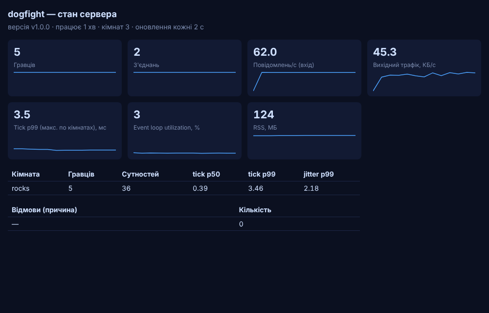

- **Версія збірки** (git SHA або тег) — у `/health`, `/api/stats`, `dogfight_build_info` і в HUD гри (Vite `define: __APP_VERSION__`). У Docker — `--build-arg APP_VERSION`.
- **Конфіг — zod** (`server/src/config.ts`): нові `ALLOWED_ORIGINS` (список URL), `MAX_CONNECTIONS_PER_IP`, `CONNECT_BURST_PER_IP`/`CONNECT_RATE_PER_IP`, `TRUST_PROXY`, `LOG_LEVEL`, `APP_VERSION`; невалідне значення — падіння на старті з назвою змінної. Усі ключі задокументовані в `server/.env.example`; `.env` у `.gitignore`.

### M2 — захист і хаос

- **Origin** перевіряється на рукостисканні (`originAllowed` у `server/src/ws.ts`): CORS на WebSocket не діє, тож без цього сторінка будь-якого сайту відкриє з'єднання від імені свого відвідувача. Правило: є `ALLOWED_ORIGINS` → точний збіг; порожньо → лише той самий хост, що в `Host`; без `Origin` (не браузер: curl, боти) → пропускаємо, ліміти діють як завжди. Відмова — HTTP 403, лічильник `bad_origin`.
- **Ліміти на IP:** не більше `MAX_CONNECTIONS_PER_IP` (8) одночасних і token bucket на **нові** з'єднання (сплеск 20, далі 2/с) — інакше цикл «підключись → насміти → тебе закрили → підключись» обходить усі ліміти на рівні сокета. За проксі IP береться з `Fly-Client-IP` / `X-Forwarded-For` (`TRUST_PROXY=1`).
- Тести: `server/test/production.test.ts` (9 тестів — origin, allow-list, ліміт на IP, проксі, ліміт швидкості підключень, `/health`+версія, `/ready` під час shutdown і без клієнта, `/metrics`, флуд сміттям).

**Хаос-тест з метрикою ізоляції** (`node server/scripts/chaos.ts`, [вивід](docs/lab-08/chaos.json)): кімната `rocks` — 8 ботів + 1 живий WS-гравець, три фази по 10 с.

| Фаза        | Що відбувається                                                                                           | tick p99 `rocks`, мс | тіків за 10 с | ELU  | відмови                             |
| ----------- | --------------------------------------------------------------------------------------------------------- | -------------------- | ------------- | ---- | ----------------------------------- |
| baseline    | тиша                                                                                                      | 1.40                 | 300           | 0.02 | —                                   |
| flood       | 20 атакувальників з одного IP: сміттєві кадри, після закриття — одразу перепідключення (≈ 10 500 спроб/с) | **3.36**             | **300**       | 0.55 | `ip_rate` 105 422, `bad_message` 59 |
| kill-client | гравця «висмикнули» (`terminate()`, без close-кадру)                                                      | 0.75                 | 300           | 0.01 | —                                   |

Висновок: під флудом **жоден тік не пропущено** (300 з 300 за 10 с), tick p99 сусідньої кімнати виріс з 1.4 до 3.4 мс — 10 % бюджету. До сокета дійшло лише 59 сміттєвих кадрів (кожен закрив своє з'єднання кодом 4001); решту відрізав token bucket на рукостисканні. ELU 0.55 — це відхилення HTTP-апгрейдів; генератор атаки працював на тих самих 2 vCPU, тож реальний запас більший. Убитий клієнт зник зі складу кімнати одразу (9 → 8), матч ішов далі.

**Сервер упав посеред матчу** — `e2e/chaos.spec.ts` (Playwright): гравець у кімнаті → `SIGTERM` серверу → вихід з кодом 0 < 5 с → у клієнта «Сервер перезапускається…» і «Повтор через N с» (експоненційний backoff з джитером) → сервер піднімається → клієнт сам перепідключається і отримує новий `welcome` у ту саму кімнату. Відхилення від тексту лаби: клієнт повертається не в лобі, а у **ту саму** кімнату — кімнати `alpha`/`rocks`/`duel` постійні, тож це коротший шлях назад у гру; якщо кімнати більше немає (код 4004), з'єднання не відновлюється і показується причина.

### M3 — контейнер і конвеєр

- **`Dockerfile`** — три етапи: `build` (усі залежності, `vite build`), `deps` (`npm ci --omit=dev -w server`), `runtime` (`node:22-alpine` + prod-залежності + `server/src`, `shared/src`, `client/dist`). Сервер не компілюється: Node виконує `.ts` сам. `package*.json` копіюються **до** коду — зміна коду не інвалідує шар `npm ci`. `USER node`, `CMD ["node", "server/src/index.ts"]` (exec-форма — `SIGTERM` іде прямо в Node), `HEALTHCHECK` через `node -e fetch(...)` (без curl). `.dockerignore` не пускає в контекст `node_modules`, `.git`, `.env`, тести, документацію.
- **Розмір образу:** _записати після `docker build` (`docker images dogfight`)_. Оцінка: базовий `node:22-alpine` ≈ 160 МБ + prod-залежності (`ws`, `zod`, `pino`, `prom-client`) ≈ 10 МБ + клієнт < 1 МБ → **≈ 170 МБ** (< 200 МБ). Точне число — з `docker images dogfight` або з кроку «Image size» у GitHub Actions.
- **`compose.yaml`** — локальний «як у продакшні» запуск: `init: true`, `read_only`, том для журналів матчів, `stop_grace_period: 15s`.
- **GitHub Actions:** `ci.yml` на кожен push і PR (typecheck → Biome → тести з покриттям → build → e2e). `deploy.yml` на тег `v*`: той самий CI як `workflow_call` → образ у GHCR з `APP_VERSION=<тег>-<sha>` → `flyctl deploy --image` → smoke-тест, що `/health` повертає **саме цю** версію.
- **`fly.toml`:** одна машина без засинання (`auto_stop_machines = "off"`, `min_machines_running = 1`), `concurrency type = "connections"`, перевірка `/ready`, `force_https` (браузер іде на `wss://`), `TRUST_PROXY=1`. Проксі Fly підтримує `Upgrade`; heartbeat кожні 15 с не дає йому закрити тихе з'єднання (idle-таймаут проксі — 60 с). `server.keepAliveTimeout = 65 с` — довше за таймаут балансувальника, щоб з'єднання закривав він, а не ми посеред запиту.

### M4 — запуск

- **PWA:** `client/public/manifest.webmanifest` (назва, іконки 192/512 + maskable + SVG, `display: fullscreen`, landscape) і `client/public/sw.js` — мінімальний service worker: навігація network-first (нова версія підхоплюється одразу), хешовані `/assets/*` — cache-first, `/api`, `/ws`, `/health`, `/metrics` — завжди повз кеш. Реєструється лише в production-збірці.
- **Демо-GIF** угорі сторінки записано скриптом `scripts/record-demo.mjs` (два headless-браузери + 3 боти, кадри обох вікон поруч → ffmpeg з власною палітрою).
- **Вручну (не автоматизується):** деплой на Fly, плейтест з двома людьми з інших мереж (RTT у таблицю вгорі), uptime-монітор на `/health` (UptimeRobot / Better Stack, раз на хвилину), встановлення PWA на телефон, демо-відео 3–5 хв.

### Reflection — тези до захисту

1. **Від `SIGTERM` до виходу:** `/ready` → 503; `server.close()` (нові HTTP не приймаються); кожному WS — `shutdown` + 1001; зупинка таймерів матчів; дочекатися закриття сокетів і запису журналів; `exit 0`; запобіжник 10 с. `CMD npm start` робить PID 1 процесом `npm` (або `sh`), який **не передає** сигнал дитині → Node нічого не знає, через 10 с Docker шле `SIGKILL` → гравці отримують обрив без 1001, журнали не дописані. Якщо ігнорувати `SIGTERM` — те саме: кожен деплой і автоскейлінг рве всі матчі.
2. **Горизонтальне масштабування:** REST без стану — будь-який інстанс обробить будь-який запит. WebSocket-кімната — це стан у пам'яті одного процесу, а з'єднання довге. Sticky sessions: балансувальник шле всіх гравців кімнати на один інстанс (хеш id кімнати). Redis pub/sub: кожен інстанс публікує input/події кімнати в канал і підписаний на нього, авторитет кімнати — один «власник», інші ретранслюють. Я лишив **один інстанс**: його ємності (≈ 500 гравців у кімнатах по 8) вистачає з запасом, а будь-яке рішення з кількома додає затримку і точки відмови.
3. **WSS:** сторінка з `https://` не може відкрити `ws://` (mixed content — браузер блокує). TLS завершується на краю Fly; далі до процесу — звичайний HTTP/WS по внутрішній мережі. Значить, проксі має підтримувати `Upgrade` і не рвати тихі з'єднання — тому heartbeat 15 с < idle-таймауту 60 с.
4. **CORS не діє на WebSocket:** браузер відкриє з'єднання з будь-якої сторінки і передасть cookie. Захист — перевірка `Origin` на сервері під час рукостискання (`originAllowed`, до `handleUpgrade`).
5. **Liveness** — «процес живий?» (ні → перезапустити). **Readiness** — «можна слати трафік?» (ні → прибрати з балансувальника, але не вбивати). Під час shutdown `/ready` = 503, а `/health` = 200: процес доробляє, його не треба вбивати.
6. **JSON у stdout:** платформа збирає stdout сама, JSON фільтрується і агрегується машиною (`jq`, Loki), файл у контейнері зникне разом з ним. `pino` у головному потоці лише серіалізує об'єкт у рядок і віддає його буферизованому писачу; «красиве» форматування, відправку в зовнішні сервіси тощо роблять транспорти в окремому worker thread (`pino.transport`) або окремий процес (`node … | pino-pretty`). Урок Лаб 4 і 7: не блокувати event loop, бо він один на всі кімнати.
7. **Багатоетапний Docker:** в етапі 1 — компілятори, Vite, TypeScript, тести, dev-залежності, кеш npm; у фінальному образі їх бути не повинно (розмір, площа атаки, час завантаження). `package*.json` перед кодом — щоб шар `npm ci` брався з кешу, поки не змінились залежності.
8. **Ємність × RTT:** _після плейтесту:_ «Ємність ≈ 500 гравців (CPU одного ядра, кімнати по 8). RTT з Києва до `waw` ≈ X мс — з інтерполяцією 100 мс і передбаченням гра комфортна до RTT ~150 мс, тобто для всієї Європи. Першим змінив би: area of interest (трафік), потім sticky-шардинг кімнат по ядрах/машинах».
9. **Падіння о 3-й ночі:** дізнаюсь від uptime-монітора (лист/пуш, `/health` не відповідає) або від Fly (машина перезапускається). Дивлюсь: `fly logs` → останній `process.crash` зі стеком і `event` перед ним; `/metrics`/дашборд — що росло до падіння (RSS, ELU, відмови); версія в `/health` — чи не свіжий деплой.
